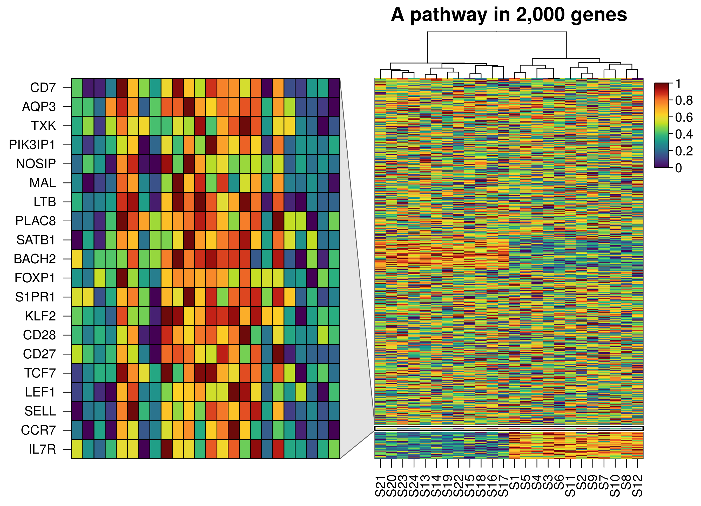
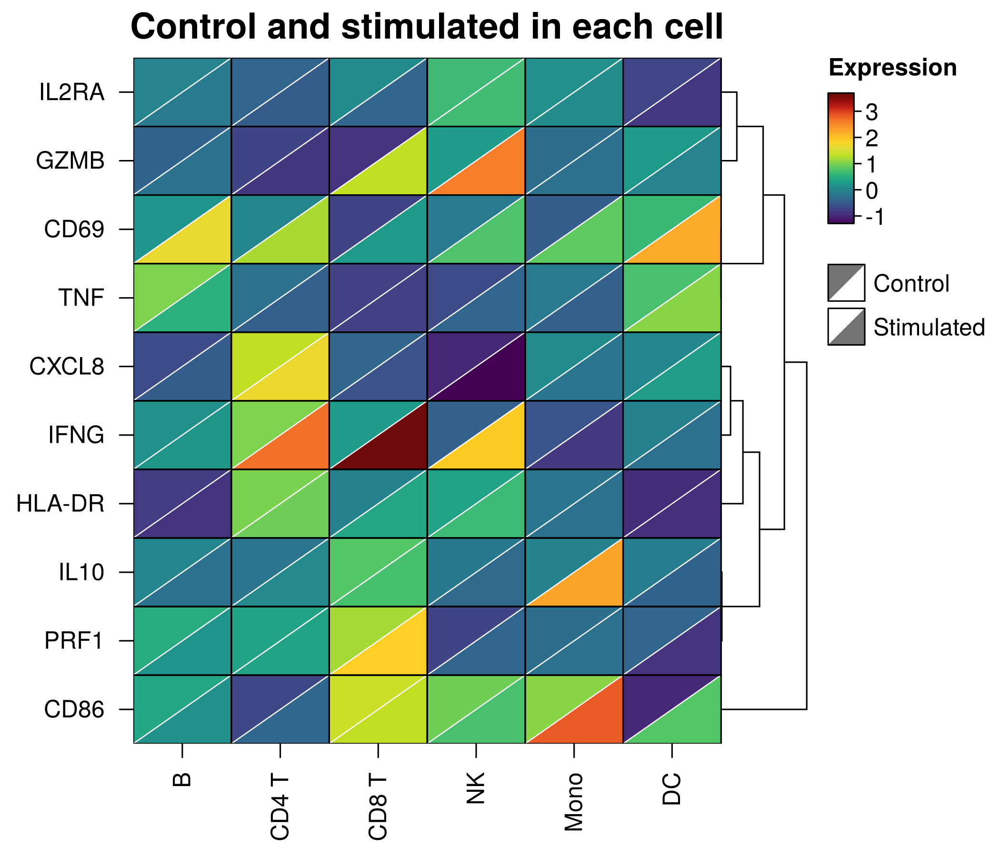
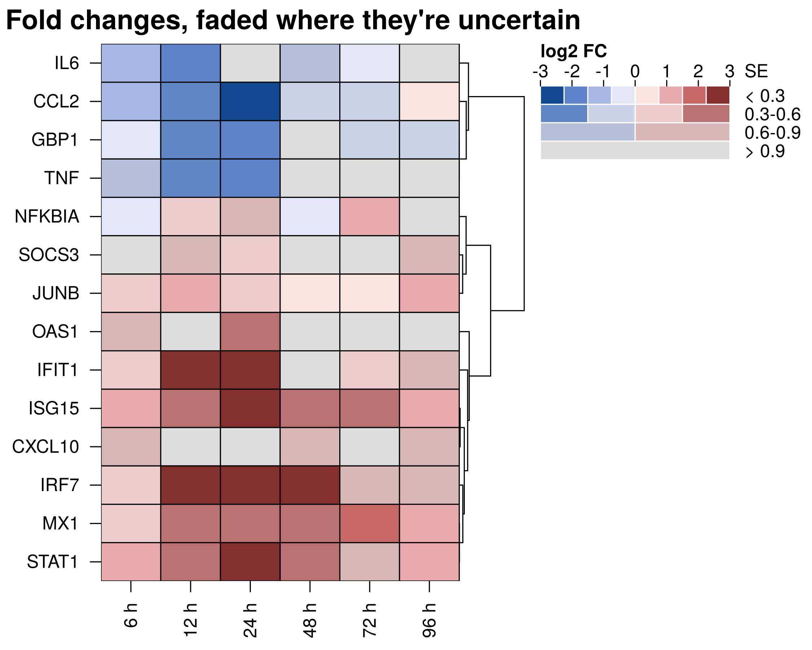
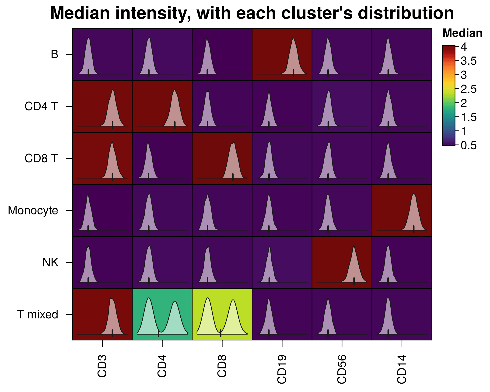
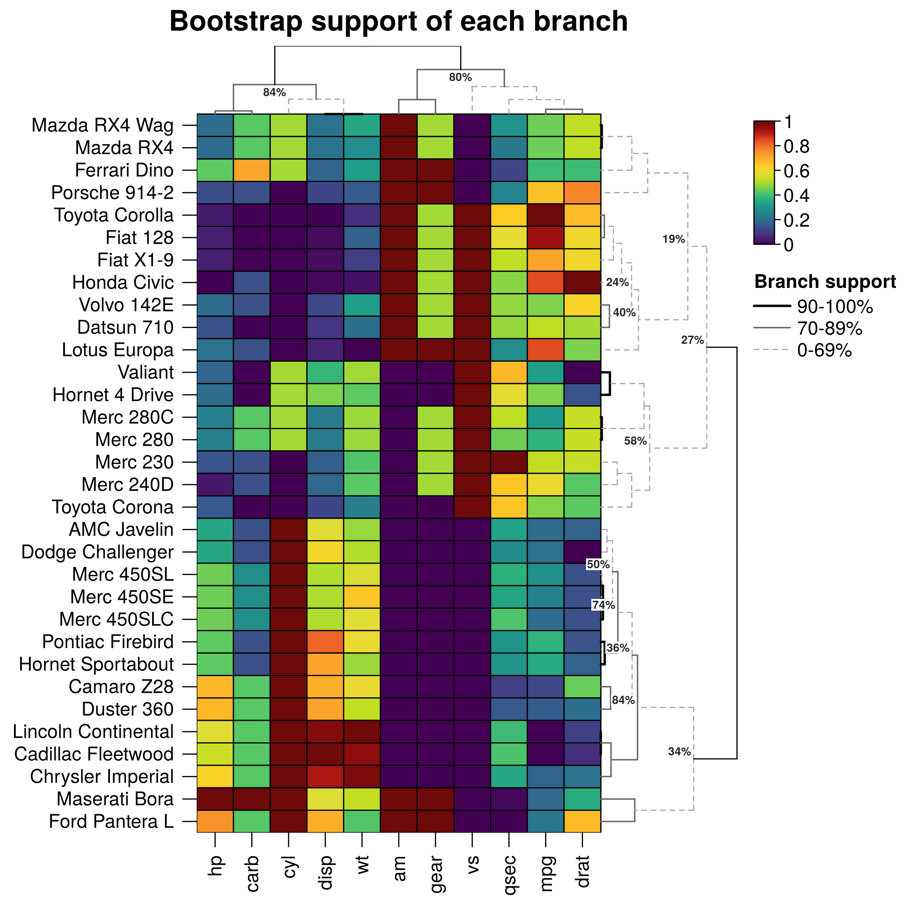
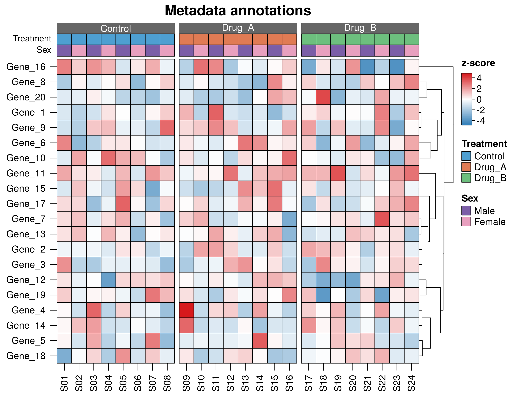
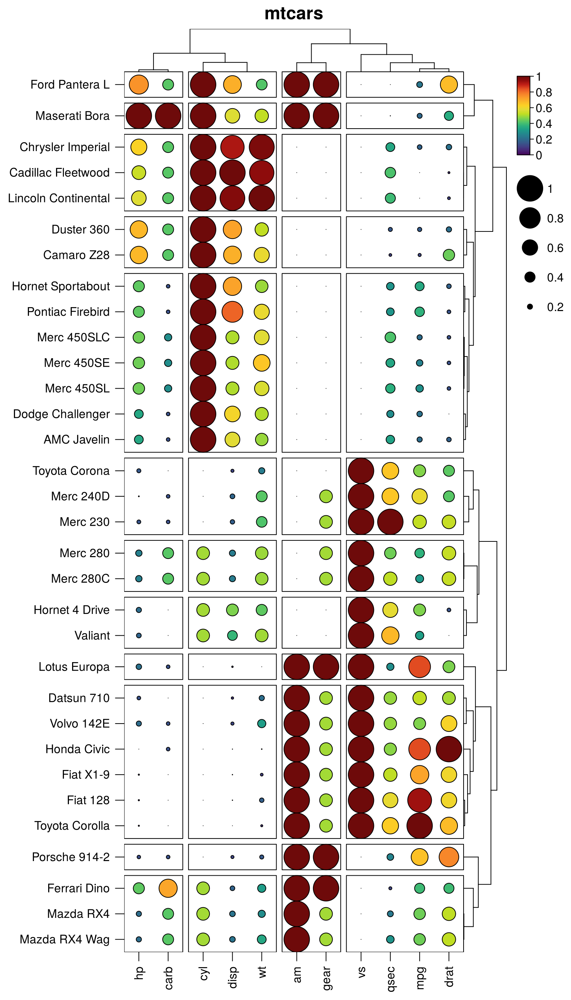

<!-- README.md is generated from README.Rmd. Please edit that file -->

```{r, include = FALSE}
knitr::opts_chunk$set(
  collapse = TRUE,
  comment = "#>",
  fig.path = "man/figures/README-",
  out.width = "100%"
)
```

# HeatmapR 

<!-- badges: start -->
[](https://www.repostatus.org/#active)
[](https://github.com/DillonHammill/HeatmapR/actions/workflows/R-CMD-check.yaml)
[](https://app.codecov.io/gh/DillonHammill/HeatmapR?branch=master)
[](https://lifecycle.r-lib.org/articles/stages.html#stable)
<!-- badges: end -->

**HeatmapR** is a lightweight R package that makes it easy to generate high quality, complex heatmaps with minimal data preprocessing or manual customization. Visit the **HeatmapR** website to get started https://dillonhammill.github.io/HeatmapR/.

## Overview
As the dimensionality of datasets continues to increase there is a need for visualisation tools such as heatmaps to present data in an easily interpretable way. The construction of complex heatmaps poses a number of challenges as they are composed multiple graphical elements, such as a coloured matrix, dendrograms, cluster sub-divisions, axes, titles and legends. The first base graphics implementation of heatmaps included `heatmap()` in the `stats` package and `heatmap.2()` in the  [gplots](https://CRAN.R-project.org/package=gplots). The packages attempt to solve these graphical challenges by treating each graphical component as a separate plot element and arranging them using `layout()`. This approach can generate complex heatmaps but it rendered users unable to arrange the heatmap with additional plot elements. **HeatmapR** aims to address these layout issues using solely a base graphics approach. 

## HeatmapR
**HeatmapR** has a number of benefits over other heatmap packages:

* **HeatmapR** is built using base graphics to remove the need for familiarity with `ggplot2` or `plotly`.
* **HeatmapR** is extremely lightweight and therefore there are no external dependencies that need to be installed.
* **HeatmapR** is designed under ROpenSci naming guidelines for a consistent and intuitive user experience.
* Unlike other heatmap packages that use base graphics, **HeatmapR** actually returns the plot object instead of an image. This makes it easy to arrange multiple plots in complex layouts without sacrificing resolution, and `heat_map_info()` returns the row/column order and cluster assignments for use in downstream analyses.
* **HeatmapR** is fully customizable and comes with useful saving API (`heat_map_save()`) to export high resolution images.
* **HeatmapR** handles datasets that contain non-numeric or missing data, which means you don't have to spend ages formatting and pre-processing the data beforehand.
* **HeatmapR** clusters large datasets quickly: distances, linkage and optimal leaf ordering run in compiled C++ code, and rows or columns beyond `clust_max` are clustered in two stages, so 100,000 rows take about 2 seconds.
* **HeatmapR** shows sample or feature metadata as annotation tracks (`annotation_x`, `annotation_y`), alongside dendrograms, cluster labels and bar plots, and adapts the layout so that labels and legends don't overlap. Dendrograms, bar plots, legends and margins are sized in inches from their contents, so they look the same whatever the shape of the data.
* **HeatmapR** generates publication ready images with minimal manual customization, making it ideal for users that have limited coding experience.

## Features

Beyond clustering, scaling and customisable colours, shapes, sizes, text, legends and layouts, **HeatmapR** can:

* **Show more than one value in each cell** - split cells to compare two conditions (`cell_split`), the distribution of the values behind each cell (`cell_values`), cell size as a second variable, and colours that fade towards grey where values are uncertain (`cell_uncertainty`).
* **Annotate rows and columns** - metadata tracks (`annotation_x`, `annotation_y`), bar graphs, box plots and violins beside the heatmap, labels for chosen rows of a large heatmap (`mark_y`) and a zoom lens that enlarges a band of rows beside the whole (`zoom_y`).
* **Cluster with confidence** - correlation and cosine distances, optimal leaf ordering, clustering within your own groups, k-means splits, and bootstrap support drawn on the dendrogram branches (`tree_support_y`).
* **Handle large data** - raster images for heatmaps with millions of cells, `heat_map_summarise()` for pseudobulk heatmaps and dot plots of groups of cells, and robust, stepped or centred colour scales with the distribution of the values traced over the legend.
* **Explain the figure** - `heat_map_info()` returns the order, clusters and layout of a heatmap, and `heat_map_describe()` writes alternative text for screen readers.
* **Work with ggplot2** - `heat_map_grob()` places heatmaps beside `ggplot2` plots in `patchwork` and `cowplot` layouts, and `heat_map_data()` returns the cells, rows, columns and dendrograms as tidy data for rebuilding or restyling them.

<table>
<tr>
<td align="center"><a href="https://dillonhammill.github.io/HeatmapR/articles/HeatmapR.html#zooming-into-a-band-of-rows"></a><br/><a href="https://dillonhammill.github.io/HeatmapR/articles/HeatmapR.html#zooming-into-a-band-of-rows">Zoom lens</a></td>
<td align="center"><a href="https://dillonhammill.github.io/HeatmapR/articles/HeatmapR.html#two-values-in-each-cell"></a><br/><a href="https://dillonhammill.github.io/HeatmapR/articles/HeatmapR.html#two-values-in-each-cell">Split cells</a></td>
<td align="center"><a href="https://dillonhammill.github.io/HeatmapR/articles/HeatmapR.html#uncertainty-in-colour"></a><br/><a href="https://dillonhammill.github.io/HeatmapR/articles/HeatmapR.html#uncertainty-in-colour">Uncertainty in colour</a></td>
</tr>
<tr>
<td align="center"><a href="https://dillonhammill.github.io/HeatmapR/articles/HeatmapR.html#distributions-inside-cells"></a><br/><a href="https://dillonhammill.github.io/HeatmapR/articles/HeatmapR.html#distributions-inside-cells">Distributions inside cells</a></td>
<td align="center"><a href="https://dillonhammill.github.io/HeatmapR/articles/HeatmapR.html#branch-support"></a><br/><a href="https://dillonhammill.github.io/HeatmapR/articles/HeatmapR.html#branch-support">Branch support</a></td>
<td align="center"><a href="https://dillonhammill.github.io/HeatmapR/articles/HeatmapR.html#metadata-annotations"></a><br/><a href="https://dillonhammill.github.io/HeatmapR/articles/HeatmapR.html#metadata-annotations">Metadata annotations</a></td>
</tr>
</table>

See the [changelog](https://dillonhammill.github.io/HeatmapR/news/index.html) for everything new in **HeatmapR** 1.2.0.

## Installation

**HeatmapR** can be installed from CRAN:

```{r, eval = FALSE, echo = TRUE}
install.packages("HeatmapR")
```

The development version can be installed directly from GitHub:

```{r, eval = FALSE, echo = TRUE}
devtools::install_github("DillonHammill/HeatmapR")
```

The development version contains C++ code, so installing it from GitHub needs a compiler: [Rtools](https://cran.r-project.org/bin/windows/Rtools/) on Windows or the Xcode command line tools on macOS.

## Usage

Creating heatmaps is as easy as loading **HeatmapR** and supplying your dataset to the `heat_map()` function. For details on customising your heatmaps, refer to the package vignette.

```{r, eval =TRUE, echo = FALSE}
library(HeatmapR)
```

```{r, eval = FALSE}
library(HeatmapR)
heat_map(
  mtcars,
  scale = "column",
  scale_method = "range",
  tree_x = TRUE,
  tree_y = TRUE,
  tree_cut_x = 4,
  tree_cut_y = 12,
  cell_size = TRUE,
  cell_shape = "circle",
  title = "mtcars"
)
```

```{r, eval = FALSE, echo = FALSE}
heat_map_save(
  "man/figures/README-HeatmapR-1.png",
  height = 14,
  width = 8,
  res = 500)
heat_map(
  mtcars,
  scale = "column",
  scale_method = "range",
  tree_x = TRUE,
  tree_y = TRUE,
  tree_cut_x = 4,
  tree_cut_y = 12,
  cell_size = TRUE,
  cell_shape = "circle",
  legend_size = 1.2,
  title = "mtcars"
)
```

```{r echo = FALSE, out.width = '95%', fig.align="center", fig.alt = "Heatmap of the mtcars data rescaled within each column, drawn as circles sized and coloured by value, with dendrograms splitting the cars into 12 groups and the variables into 4 groups."}

```

## Acknowledgements
**HeatmapR** relies on statistical methods in the `stats` package to compute distance matrices and perform hierarchical clustering. The dendrogram line segments follow the layout used by the [ggdendro](https://github.com/andrie/ggdendro) package, which earlier versions of **HeatmapR** used modified code from. 

## Code of Conduct

Please note that the HeatmapR project is released with a [Contributor Code of Conduct](https://contributor-covenant.org/version/2/0/CODE_OF_CONDUCT.html). By contributing to this project, you agree to abide by its terms.

## Citation

If you use **HeatmapR** for your work please cite the package as follows:

```{r, eval = TRUE}
citation("HeatmapR")
```
