<!-- README.md is generated from README.Rmd. Please edit that file -->

# HeatmapR 

<!-- badges: start -->

[](https://CRAN.R-project.org/package=HeatmapR)
[](https://CRAN.R-project.org/package=HeatmapR)
[](https://www.repostatus.org/#active)
[](https://github.com/DillonHammill/HeatmapR/actions/workflows/R-CMD-check.yaml)
[](https://app.codecov.io/gh/DillonHammill/HeatmapR?branch=master)
[](https://lifecycle.r-lib.org/articles/stages.html#stable)
<!-- badges: end -->

**HeatmapR** draws complex, publication-ready heatmaps in R. It handles
everything from a quick look at a table to clustered heatmaps of
hundreds of thousands of cells. Dendrograms, annotations and legends are
laid out for you, and there are dot plots and other plots for
single-cell data. It is fast enough for single-cell data, needs nothing
beyond R to install, and comes with an app to build heatmaps in the
browser. Visit the [website](https://dillonhammill.github.io/HeatmapR/)
to get started.

## Why HeatmapR?

- **Much faster, with a fraction of the memory.** Clustering and drawing
  a heatmap of 20,000 rows takes **0.6 seconds and 114 MB**. pheatmap,
  `heatmap.2()`, `stats::heatmap()` and ComplexHeatmap take 32 seconds
  to 2 minutes and 3.3 to 4.7 GB. HeatmapR clusters large data in two
  stages by default; clustering exactly, as the others do, it takes 7.1
  seconds and 1.5 GB. A 3,000 × 3,000 matrix takes 4 seconds instead of
  over 4 minutes. 100,000 rows take 1.2 seconds, where every other
  package ran out of memory.
- **Built for single-cell data.** `heat_map()` takes
  `SingleCellExperiment`, `Seurat`, `flowSet` and AnnData data as they
  are, as well as sparse and on-disk matrices. Features are chosen by
  name, and cells are grouped and annotated by their metadata. There are
  also dot plots, markers, gene-set scores, compositions, contrasts and
  trajectories. A heatmap of 40 genes in 100,000 cells takes 1.3
  seconds, against 40 seconds and 2.8 GB with Seurat’s `DoHeatmap()`.
- **Complete figures from one call.** Dendrograms, cluster splits,
  annotation tracks, bar plots, labels and legends are sized in inches
  from their contents. They’re laid out so that nothing overlaps,
  whatever the shape of the data or the size of the image, and
  `heat_map_save()` writes the figure at print resolution.
- **Point, click and keep the code.** `heat_map_app()` builds heatmaps
  in the browser and writes the R code that draws them again.
  `heat_map_html()` turns any heatmap into a web page to explore: hover
  for values, select rows and columns, search and zoom.
- **Ready for publication and analysis.**
  - `heat_map_describe()` writes alternative text for screen readers.
  - `heat_map_check_colours()` finds colours that colour-blind readers
    can’t tell apart.
  - `heat_map_info()` returns the order and clusters of the rows and
    columns for the rest of your analysis.
- **Nothing else to install.** HeatmapR uses base graphics and compiled
  C++, with no dependencies beyond R. pheatmap installs 13 other
  packages, ComplexHeatmap 18 and Seurat 129. HeatmapR is MIT licensed.

### HeatmapR and the alternatives

Time to draw a heatmap, in seconds, and the peak memory for 20,000 rows:

|                              |                   HeatmapR |      pheatmap | ComplexHeatmap | `heatmap.2()` | `stats::heatmap()` |
|:-----------------------------|---------------------------:|--------------:|---------------:|--------------:|-------------------:|
| Clustered, 20,000 × 30       |       **0.6** (exact: 7.1) |            32 |            130 |            48 |                 45 |
| Peak memory, 20,000 × 30     | **114 MB** (exact: 1.5 GB) |        4.7 GB |         3.7 GB |        4.7 GB |             3.3 GB |
| Clustered, 3,000 × 3,000     |                    **3.7** |           254 |            275 |           253 |                249 |
| Clustered, 100,000 × 30      |                    **1.2** | out of memory |  out of memory | out of memory |      out of memory |
| Not clustered, 3,000 × 3,000 |                    **0.6** |           8.8 |             26 |           250 |                4.5 |
| Other packages installed     |                      **0** |            13 |             18 |             3 |                  0 |

For single-cell data, against Seurat and scran:

|                                                     |   HeatmapR |                 Seurat or scran |
|:----------------------------------------------------|-----------:|--------------------------------:|
| Heatmap of 40 genes in 100,000 cells                |  **1.3 s** |    40 s, 2.8 GB (`DoHeatmap()`) |
| Dot plot of 40 genes in 100,000 cells               | **0.17 s** |             1.9 s (`DotPlot()`) |
| Markers of 12 groups, 20,000 cells and 20,000 genes |  **0.4 s** | 19 s (scran’s `scoreMarkers()`) |

All times were measured on two cores with 7.8 GB of memory. For small
heatmaps, every package takes about a tenth of a second, except
ComplexHeatmap at about two seconds. The methods, and every size
measured, are in the [speed
comparison](https://dillonhammill.github.io/HeatmapR/articles/benchmarks.html)
and the [single-cell
guide](https://dillonhammill.github.io/HeatmapR/articles/single-cell.html#speed).
The numbers of packages are for the versions compared there.

## Features

Beyond clustering, scaling and customisable colours, shapes, sizes,
text, legends and layouts, **HeatmapR** can:

- **Show more than one value in each cell:**
  - split cells to compare two conditions (`cell_split`);
  - show the distribution of the values behind each cell
    (`cell_values`);
  - use cell size as a second variable;
  - fade colours towards grey where values are uncertain
    (`cell_uncertainty`).
- **Annotate rows and columns:**
  - metadata tracks (`annotation_x`, `annotation_y`);
  - bar graphs, box plots and violins beside the heatmap;
  - labels for chosen rows of a large heatmap (`mark_y`);
  - a zoom lens that enlarges a band of rows beside the whole
    (`zoom_y`).
- **Cluster with confidence:**
  - correlation and cosine distances;
  - optimal leaf ordering;
  - clustering within your own groups;
  - k-means splits;
  - bootstrap support drawn on the dendrogram branches
    (`tree_support_y`).
- **Handle large data:**
  - raster images for heatmaps with millions of cells;
  - two-stage clustering for a million rows;
  - `heat_map_summarise()` for pseudobulk heatmaps and dot plots of
    groups of cells;
  - robust, stepped or centred colour scales, with the distribution of
    the values traced over the legend.
- **Work with ggplot2:**
  - `heat_map_grob()` places heatmaps beside `ggplot2` plots in
    `patchwork` and `cowplot` layouts;
  - `heat_map_data()` returns the cells, rows, columns and dendrograms
    as tidy data, for rebuilding or restyling them.

<table>
<tr>
<td align="center">
<a href="https://dillonhammill.github.io/HeatmapR/articles/HeatmapR.html#zooming-into-a-band-of-rows">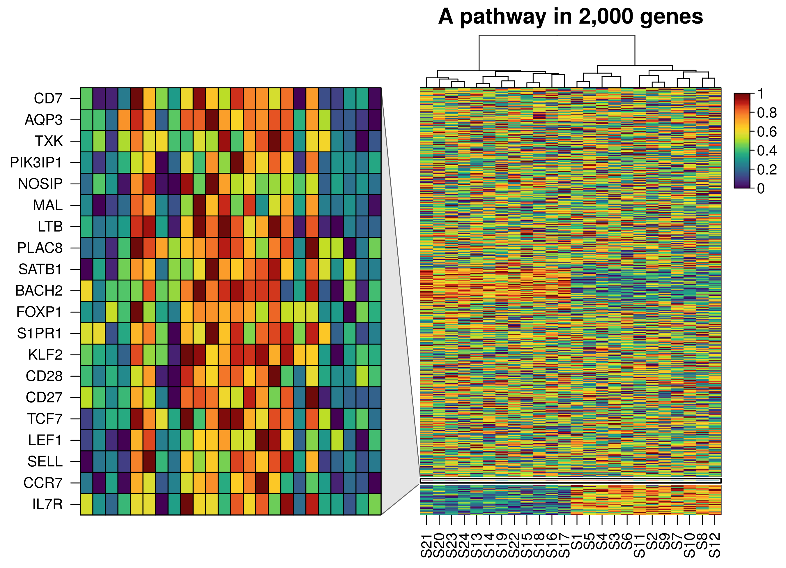</a><br/><a href="https://dillonhammill.github.io/HeatmapR/articles/HeatmapR.html#zooming-into-a-band-of-rows">Zoom
lens</a>
</td>
<td align="center">
<a href="https://dillonhammill.github.io/HeatmapR/articles/HeatmapR.html#two-values-in-each-cell">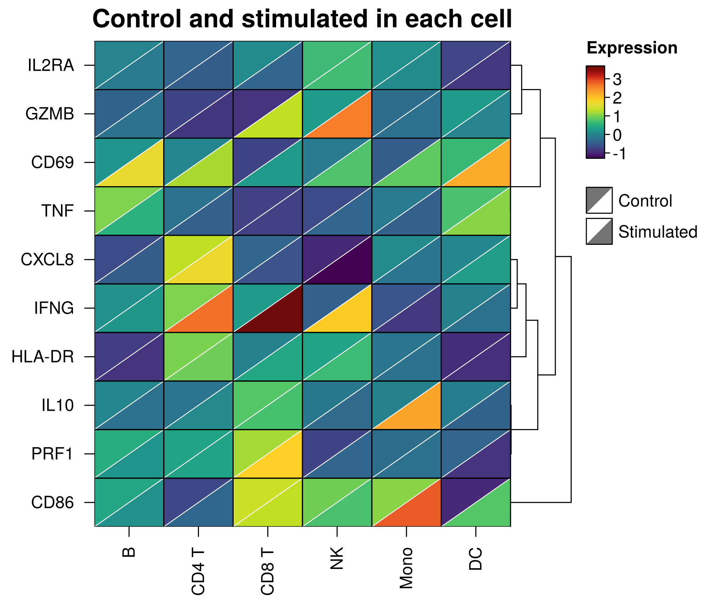</a><br/><a href="https://dillonhammill.github.io/HeatmapR/articles/HeatmapR.html#two-values-in-each-cell">Split
cells</a>
</td>
<td align="center">
<a href="https://dillonhammill.github.io/HeatmapR/articles/HeatmapR.html#uncertainty-in-colour">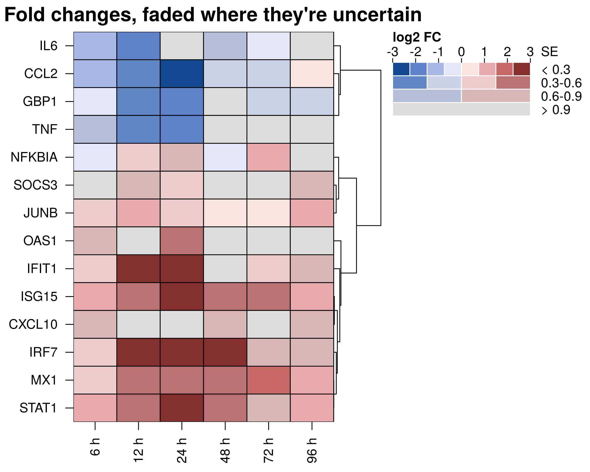</a><br/><a href="https://dillonhammill.github.io/HeatmapR/articles/HeatmapR.html#uncertainty-in-colour">Uncertainty
in colour</a>
</td>
</tr>
<tr>
<td align="center">
<a href="https://dillonhammill.github.io/HeatmapR/articles/HeatmapR.html#distributions-inside-cells">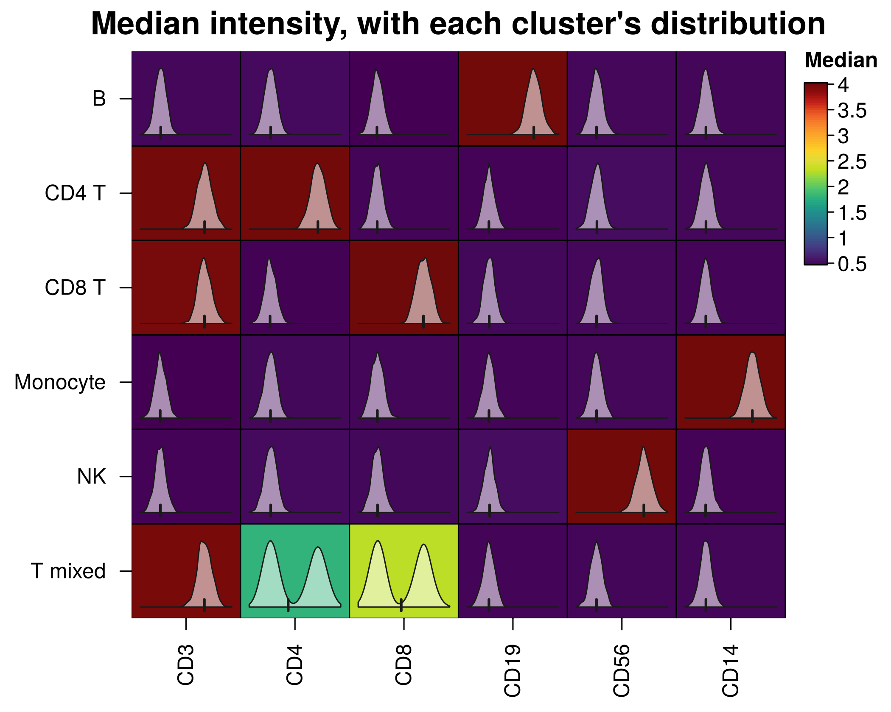</a><br/><a href="https://dillonhammill.github.io/HeatmapR/articles/HeatmapR.html#distributions-inside-cells">Distributions
inside cells</a>
</td>
<td align="center">
<a href="https://dillonhammill.github.io/HeatmapR/articles/HeatmapR.html#branch-support">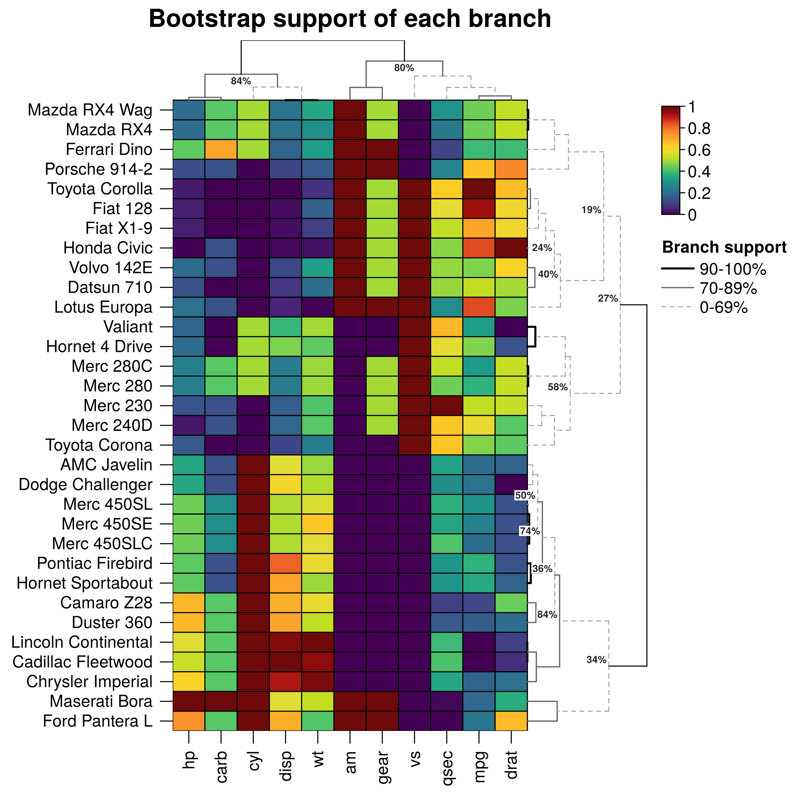</a><br/><a href="https://dillonhammill.github.io/HeatmapR/articles/HeatmapR.html#branch-support">Branch
support</a>
</td>
<td align="center">
<a href="https://dillonhammill.github.io/HeatmapR/articles/HeatmapR.html#metadata-annotations">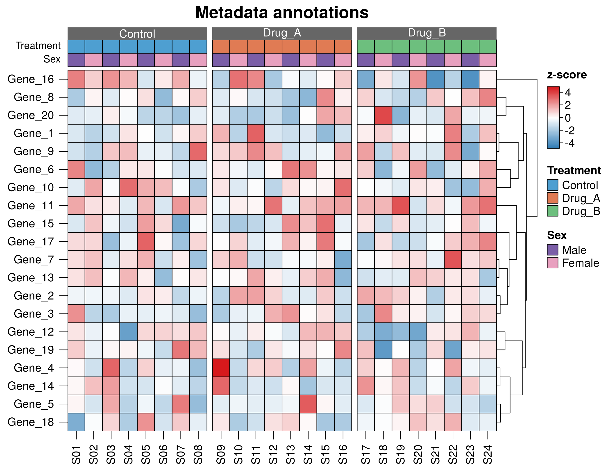</a><br/><a href="https://dillonhammill.github.io/HeatmapR/articles/HeatmapR.html#metadata-annotations">Metadata
annotations</a>
</td>
</tr>
</table>

## Build heatmaps in the browser

`heat_map_app()` opens an app to build a heatmap without writing code.
You can drop a table or a single-cell file on it, or start it from data
in R. Then:

- choose a heatmap, a dot plot or a correlation heatmap;
- set any argument of `heat_map()` while the heatmap redraws, with
  values on hover and selections on the heatmap;
- download the figure, with the R code that draws it again.

It needs the shiny and bslib packages. [Building heatmaps in the
browser](https://dillonhammill.github.io/HeatmapR/articles/app.html)
shows how it works.

``` r
heat_map_app()                                         # drop a file, or choose an example
heat_map_app(mtcars, scale = "column", tree = "both")  # start from data in R
```

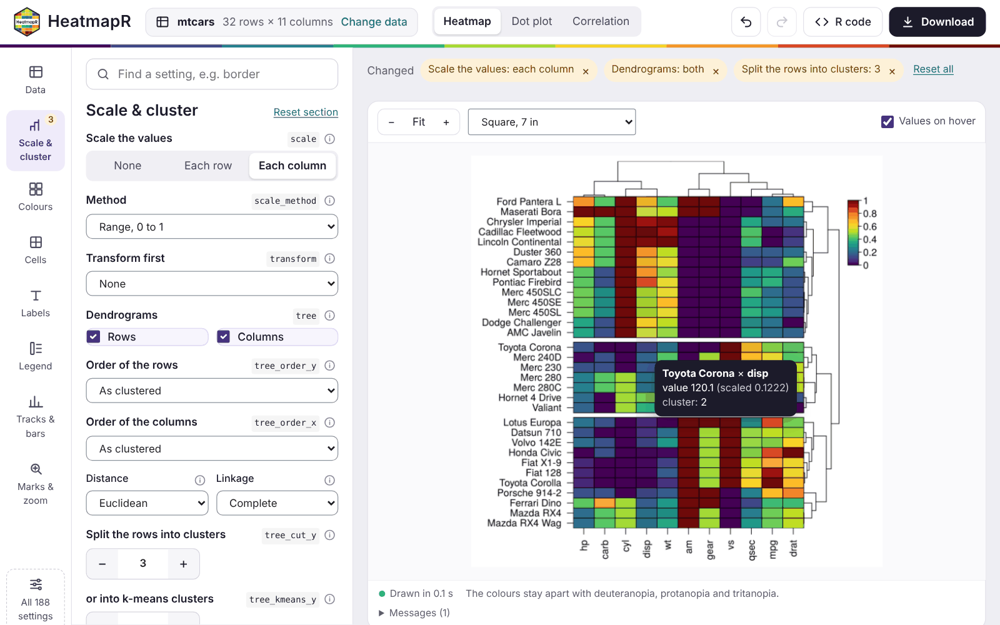

`heat_map_html()` writes any heatmap as a single web page that works
without R. Hover for values; click or drag over cells, labels and
dendrograms to select rows and columns; then copy or download the
selection, search and zoom.

## Single-cell data

**HeatmapR** reads single-cell data where it lives -
`SingleCellExperiment` and `Seurat` objects, `flowFrame` and `flowSet`
objects, AnnData (`.h5ad`) files and sparse matrices, in memory or on
disk (DelayedArray, HDF5Array and BPCells) - choosing features by name
and grouping and annotating cells from their metadata. Only the chosen
features of the cells shown are made dense, so a few markers of a
million cells need little memory, and summaries, markers and scores of
every gene read on-disk data a block of genes at a time.

- **Dot plots, markers and gene-set scores** - `heat_map_dot()` draws
  the mean of each group as colour and the proportion of its cells
  detected as size (or two conditions in the halves of each dot),
  `heat_map_markers()` ranks the markers of each group by their AUC,
  with Wilcoxon p-values, ready to pass to `features` or to draw as a
  dot plot, and `heat_map_score()` scores each cell for sets of genes
  (z-scored means or module scores).
- **Compositions and contrasts** - `heat_map_composition()` draws the
  share of each cell type in each sample, and `heat_map_contrast()` the
  log fold change between two conditions in each cluster, tested on
  pseudobulks with the samples as replicates.
- **Aligned heatmaps** - `heat_map_align()` lines up data sets measured
  on the same cells or groups, such as genes and surface proteins, as
  blocks of one heatmap, each scaled and coloured on its own with its
  own legend, with the rows clustered on one of them.
- **Summaries of groups** - `heat_map_summarise()` finds the mean,
  median, sum or proportion detected of each feature in each group of
  cells from sparse data in compiled code, and `group_max` keeps small
  groups visible next to large ones.
- **Cytometry** - the asinh transform and quantile scaling of markers,
  the medians of clusters in each sample, and stacked bars of the events
  of each condition in each cluster.
- **Trajectories** - `heat_map_smooth()` smooths genes along pseudotime,
  one lineage at a time, and `tree_order_y = "peak"` orders them by when
  they peak.

`heat_map_example()` simulates blood cells, cytometry events and a
branching trajectory to try them on:

``` r
cells <- heat_map_example("rna")
markers <- heat_map_markers(cells, group_by = "cell_type", n = 3)
heat_map_dot(cells, features = markers, group_by = "cell_type")
```

<table>
<tr>
<td align="center">
<a href="https://dillonhammill.github.io/HeatmapR/articles/single-cell.html#dot-plots">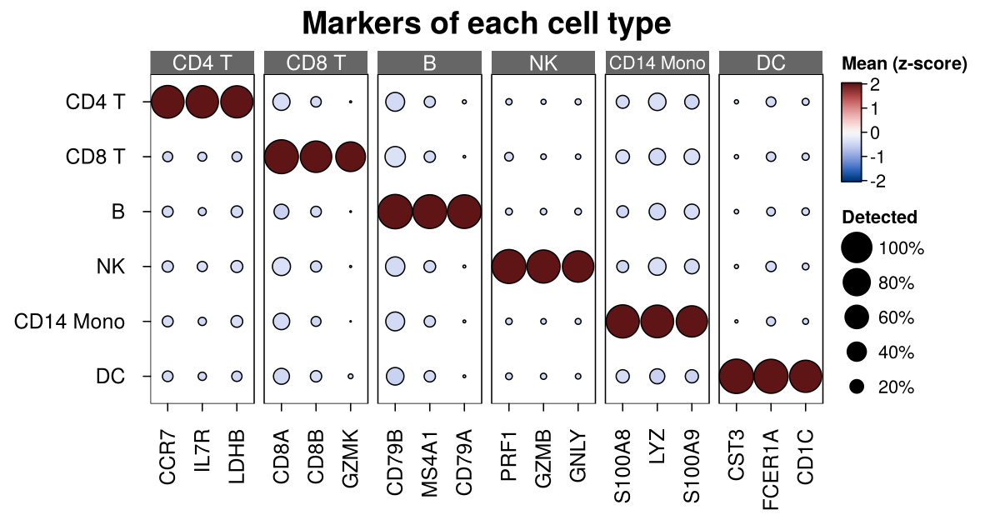</a><br/><a href="https://dillonhammill.github.io/HeatmapR/articles/single-cell.html#dot-plots">Dot
plots</a>
</td>
<td align="center">
<a href="https://dillonhammill.github.io/HeatmapR/articles/single-cell.html#markers">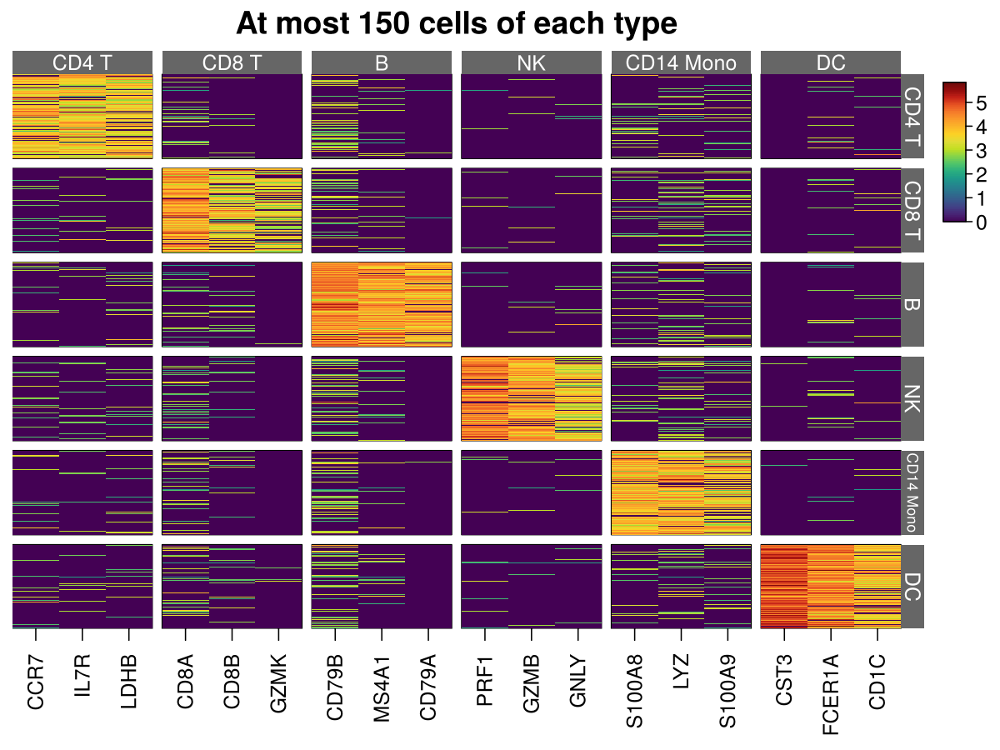</a><br/><a href="https://dillonhammill.github.io/HeatmapR/articles/single-cell.html#markers">Markers
of each group</a>
</td>
</tr>
<tr>
<td align="center">
<a href="https://dillonhammill.github.io/HeatmapR/articles/single-cell.html#cytometry">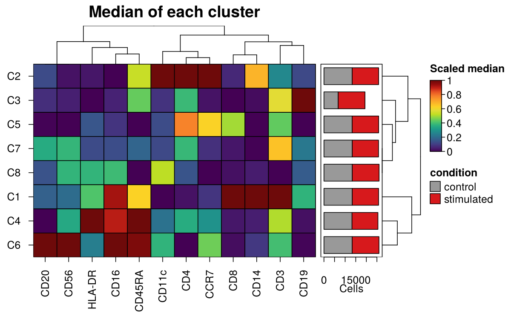</a><br/><a href="https://dillonhammill.github.io/HeatmapR/articles/single-cell.html#cytometry">Cytometry
clusters</a>
</td>
<td align="center">
<a href="https://dillonhammill.github.io/HeatmapR/articles/single-cell.html#trajectories">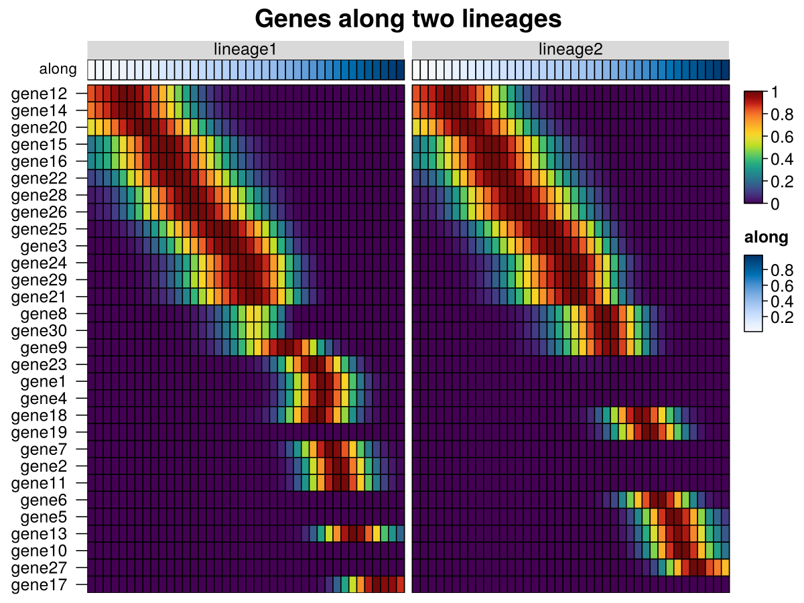</a><br/><a href="https://dillonhammill.github.io/HeatmapR/articles/single-cell.html#trajectories">Trajectories</a>
</td>
</tr>
</table>

The
[guides](https://dillonhammill.github.io/HeatmapR/articles/index.html)
on the website cover ordering, large heatmaps, [single-cell
data](https://dillonhammill.github.io/HeatmapR/articles/single-cell.html),
cells, and working with other packages, and the
[changelog](https://dillonhammill.github.io/HeatmapR/news/index.html)
lists everything new in **HeatmapR** 2.0.0.

## Installation

**HeatmapR** can be installed from CRAN:

``` r
install.packages("HeatmapR")
```

The development version can be installed directly from GitHub:

``` r
devtools::install_github("DillonHammill/HeatmapR")
```

**HeatmapR** contains C++ code: CRAN provides ready-built binaries for
Windows and macOS, but installing from GitHub (or from source) needs a
compiler - [Rtools](https://cran.r-project.org/bin/windows/Rtools/) on
Windows or the Xcode command line tools on macOS.

## Usage

Creating heatmaps is as easy as loading **HeatmapR** and supplying your
dataset to the `heat_map()` function. For details on customising your
heatmaps, refer to the package vignette.

``` r
library(HeatmapR)
heat_map(
  mtcars,
  scale = "column",
  scale_method = "range",
  tree_x = TRUE,
  tree_y = TRUE,
  tree_cut_x = 4,
  tree_cut_y = 12,
  cell_size = TRUE,
  cell_shape = "circle",
  title = "mtcars"
)
```

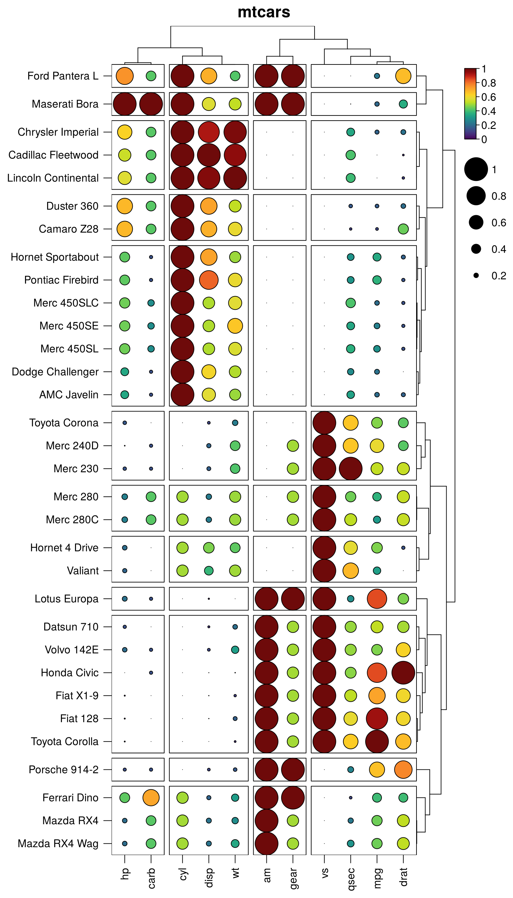

## Acknowledgements

**HeatmapR** computes distances and hierarchical clustering in compiled
code that follows the methods of the `stats` package (`stats::dist()`
and `stats::hclust()`), which it still uses for the methods the compiled
code doesn’t cover. Dendrograms are drawn by **HeatmapR**’s own code.
Versions up to 1.1.0 drew them with modified functions of the
[ggdendro](https://github.com/andrie/ggdendro) package, which were
removed in 2.0.0.

## Code of Conduct

Please note that the HeatmapR project is released with a [Contributor
Code of
Conduct](https://contributor-covenant.org/version/2/0/CODE_OF_CONDUCT.html).
By contributing to this project, you agree to abide by its terms.

## Citation

If you use **HeatmapR** for your work please cite the package as
follows:

``` r
citation("HeatmapR")
#> To cite package 'HeatmapR' in publications use:
#> 
#>   Hammill D (2026). _HeatmapR: Create Heatmaps Using Base Graphics_. R
#>   package version 2.0.0, <https://dillonhammill.github.io/HeatmapR/>.
#> 
#> A BibTeX entry for LaTeX users is
#> 
#>   @Manual{,
#>     title = {HeatmapR: Create Heatmaps Using Base Graphics},
#>     author = {Dillon Hammill},
#>     year = {2026},
#>     note = {R package version 2.0.0},
#>     url = {https://dillonhammill.github.io/HeatmapR/},
#>   }
```
