```{r, include = FALSE}
knitr::opts_chunk$set(
  collapse = TRUE,
  comment = "#>"
)
```

## Overview

**HeatmapR** is a lightweight R package that uses base graphics to facilitate the creation of high quality complex heatmaps that can be easily arranged with other plots. In this vignette, we will explore the key features of `HeatmapR` and describe the usage of each of the key functions in `HeatmapR` as summarised below:

-   `heat_map()` convenient wrapper around all `HeatmapR` functions providing an intuitive way to create complex heatmaps using base graphics.
-   `heat_map_clust()` is used inside `heat_map()` to perform hierarchical clustering on the dataset using `stats::hclust()`.
-   `heat_map_scale()` is used inside `heat_map()` to apply column- or row-wise mean, z-score or range scaling to the dataset prior to constructing the heatmap.
-   `heat_map_summarise()` reduces groups of rows or columns to one summary each (e.g. the mean expression of each cell type), or keeps the values of each group for distributions inside the cells.
-   `heat_map_info()` returns the data, row and column order, clusters, colours and layout of a heatmap for downstream analyses.
-   `heat_map_describe()` writes a plain-language description of a heatmap to use as alternative text for screen readers.
-   `heat_map_data()` returns the cells, rows, columns and dendrograms of a heatmap as tidy tables, and `heat_map_grob()` places heatmaps beside `ggplot2` plots.
-   `heat_map_layout()` allows you to create custom plot layouts to arrange multiple heatmaps.
-   `heat_map_save()` can be called prior to any `heat_map()` call to save a high resolution image.
-   `heat_map_record()` can be called after any `heat_map()` calls to record the current plot for saving to an R object.
-   `heat_map_complete()` can be called when creating complex layouts to indicate when the resulting layout should be saved to file using `heat_map_save()`.
-   `heat_map_reset()` resets all **HeatmapR** associated settings in case things are not working as they should.

## 1. Construct a Basic Heatmap

Constructing a heatmap is as simple loading the **HeatmapR** package and supplying your dataset to the `heat_map()` function. The constructed heatmap will be in the same orientation as the input data, the first row at the top and the first column at the left as when the data is printed, and each numeric cell in the heatmap will be coloured using the colour scale supplied to `cell_col_scale`. By default, `heat_map()` uses a hybrid colour blind friendly `viridis` palette to offer high visual contrast.

```{r, echo = FALSE, eval = TRUE}
library(HeatmapR)
```

```{r, eval = FALSE}
library(HeatmapR)
heat_map(mtcars)
```

```{r, eval = FALSE, echo = FALSE}
heat_map_save(
  "vignettes/HeatmapR/HeatmapR-1.png",
  height = 7,
  width = 9,
  res = 500
)
heat_map(mtcars)
```

```{r echo = FALSE, out.width = '95%', fig.align="center"}
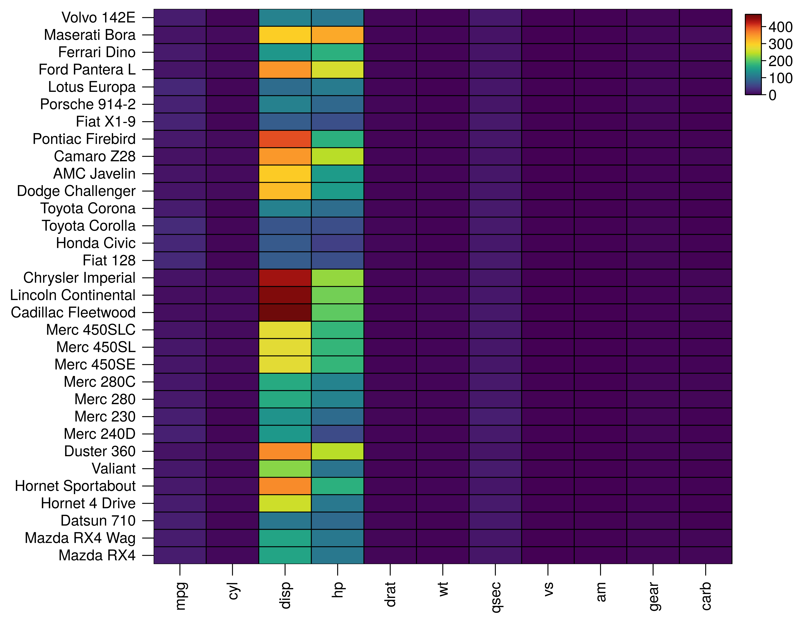
```

## 2. Cell Properties

`heat_map()` contains a family of `cell_` arguments which allow for the customisation of the shape, size, colour, borders and text of cells within a heatmap. In the examples below, we will apply the same properties to every cell within the heatmap, but it is also possible to modify these properties per cell by supplying a matrix matching the dimensionality and orientation of the input matrix.

### 2.1 Cell Shape

`heat_map()` supports different cell shapes through the `cell_shape` argument which can be set to `"rect"` (default), `"circle"`, `"diamond"`, `"ellipse"`, `"number"` or `"none"`. Circles and diamonds stay round when the cells aren't square, sized by the shorter side of the cells. Ellipses show values between -1 and 1, such as correlations, by their shape, `"number"` writes each value in the colour of its cell, and `"none"` leaves a cell empty (see [Correlation Matrices](#correlation-matrices)). Where cells are drawn as shapes that don't fill them, `cell_grid_line_col` (e.g. `"grey85"`) draws a light grid around the cells.

```{r, eval = FALSE}
heat_map(
  mtcars,
  cell_shape = "circle"
)
```

```{r, eval = FALSE, echo = FALSE}
heat_map_save(
  "vignettes/HeatmapR/HeatmapR-3.png",
  height = 11,
  width = 7,
  res = 500
)
heat_map(
  mtcars,
  cell_shape = "circle"
)
```

```{r echo = FALSE, out.width = '95%', fig.align="center"}
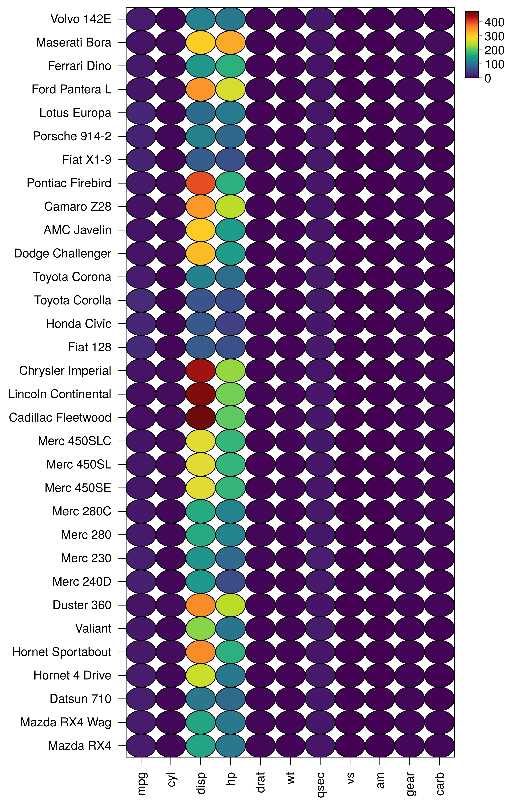
```

```{r, eval = FALSE}
heat_map(
  mtcars,
  cell_shape = "diamond"
)
```

```{r, eval = FALSE, echo = FALSE}
heat_map_save(
  "vignettes/HeatmapR/HeatmapR-4.png",
  height = 11,
  width = 7,
  res = 500
)
heat_map(
  mtcars,
  cell_shape = "diamond"
)
```

```{r echo = FALSE, out.width = '95%', fig.align="center"}
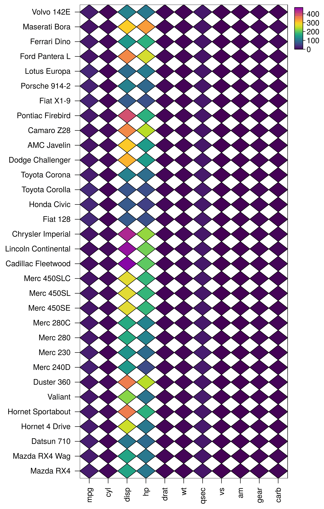
```

### 2.2 Cell Size

The size of each cell is controlled through the `cell_size` argument. Setting `cell_size = TRUE` will scale the size of each cell based on its value in the input matrix. Alternatively, users can supply a separate matrix of the same dimensionality and orientation as the input matrix to control the size of the cells independently of their colour.

```{r, eval = FALSE}
heat_map(
  mtcars,
  cell_shape = "circle",
  cell_size = TRUE
)
```

```{r, eval = FALSE, echo = FALSE}
heat_map_save(
  "vignettes/HeatmapR/HeatmapR-5.png",
  height = 11,
  width = 7,
  res = 500
)
heat_map(
  mtcars,
  cell_shape = "circle",
  cell_size = TRUE,
  legend_size = 1.5
)
```

```{r echo = FALSE, out.width = '95%', fig.align="center"}
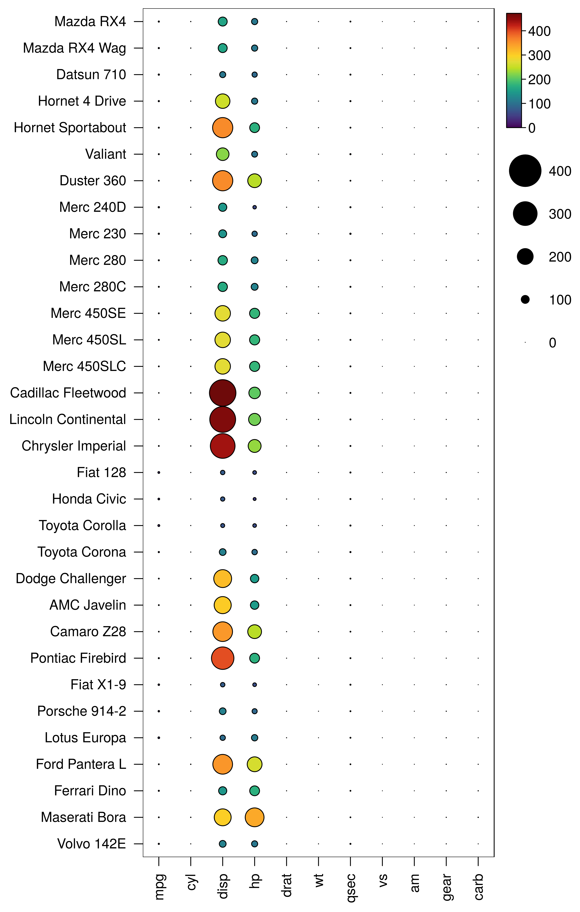
```

### 2.3 Cell Colours

The colour of each cell in the heatmap is dependent on the type of data in that cell. Cells containing numeric values will be assigned colours based on the continuous colour scale supplied to `cell_col_scale`, whilst cells containing non-numeric values will be assigned colours from the discrete colour palette supplied to `cell_col_palette`. Missing values of the form `NA` are also supported and the colour of cells containing missing values can be controlled through the `cell_col_empty` argument. The `cell_col_alpha` argument accepts values ranging from zero (transparent) to one (solid) to for fine control over the transparency of the colour in each cell of the heatmap. In the example below, we will demonstrate the handling of different data types within `heat_map()`  using a modified subset of the `iris` dataset where additional missing values have been introduced:

```{r, eval = TRUE, echo = FALSE}
set.seed(2022)
```

```{r, eval = FALSE}
# Modified subset of iris dataset with missing values
iris_sub <- iris[sample(1:nrow(iris), 25), ]
iris_sub[c(2, 19, 14, 7), 2] <- NA
iris_sub[c(4, 9, 17, 25), 3] <- NA

# Build heatmap
heat_map(
  iris_sub,
  cell_text = TRUE,
  cell_col_empty = "grey40",
  cell_col_scale = c(
    "yellow",
    "orange",
    "red",
    "black"
  ),
  cell_col_palette = c(
    "magenta",
    "blue",
    "green3"
  ),
  cell_col_alpha = 1
)
```

```{r, eval = FALSE, echo = FALSE}
heat_map_save(
  "vignettes/HeatmapR/HeatmapR-2.png",
  height = 7,
  width = 7,
  res = 500
)
iris_sub <- iris[sample(1:nrow(iris), 25), ]
iris_sub[c(2, 19, 14, 7), 2] <- NA
iris_sub[c(4, 9, 17, 25), 3] <- NA
heat_map(
  iris_sub,
  cell_text = TRUE,
  cell_col_empty = "grey40",
  cell_col_scale = c(
    "yellow",
    "orange",
    "red",
    "black"
  ),
  cell_col_palette = c(
    "magenta",
    "blue",
    "green3"
  ),
  cell_col_alpha = 1
)
```

```{r echo = FALSE, out.width = '95%', fig.align="center"}
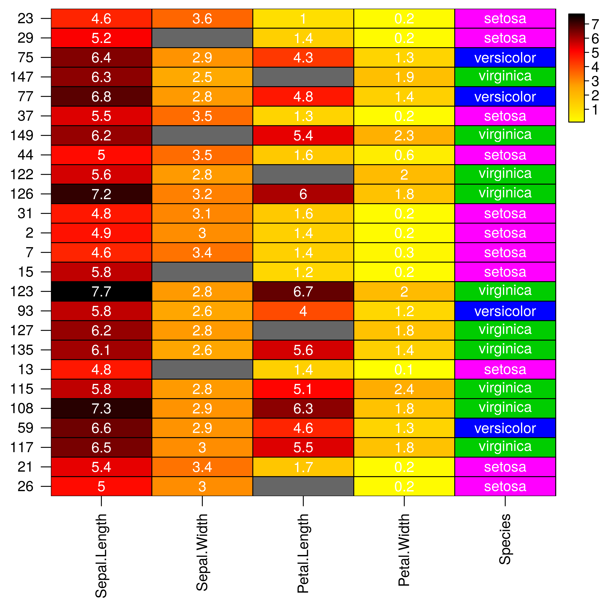
```

#### 2.3.1 Uncertainty in Colour

Estimates such as fold changes come with uncertainty, and a noisy estimate shouldn't look as strong as a precise one. `cell_uncertainty` takes a matrix of uncertainties (standard errors, confidence interval widths or p-values) and colours the cells with a value-suppressing palette: the more uncertain a value, the fewer colours its part of the scale has and the closer they are to grey. Precise values use eight colours across the scale, then four, two, and the most uncertain values a single, nearly grey colour. `cell_uncertainty_breaks` sets the thresholds between the levels, and the colour legend becomes a key with one row per level.

```{r, eval = FALSE}
set.seed(3)
genes <- c("IFIT1", "ISG15", "MX1", "OAS1", "IRF7", "STAT1", "CXCL10",
           "GBP1", "IL6", "TNF", "CCL2", "NFKBIA", "SOCS3", "JUNB")
times <- c("6 h", "12 h", "24 h", "48 h", "72 h", "96 h")
# log2 fold changes and their standard errors
lfc <- outer(
  c(rep(2.4, 7), rep(-1.6, 4), rep(0.6, 3)),
  c(0.5, 1, 1.2, 1, 0.7, 0.4)
) + matrix(rnorm(84, 0, 0.5), 14)
se <- matrix(rgamma(84, 2, 6), 14) *
  rep(c(1, 1, 1, 3, 1, 1, 4, 1, 2.5, 3.5, 1, 1, 5, 1), 6)
dimnames(lfc) <- dimnames(se) <- list(genes, times)
heat_map(
  lfc,
  tree_y = TRUE,
  cell_col_scale = "Blue-Red 3",
  cell_col_scale_limits = c(-3, 3),
  cell_uncertainty = se,
  cell_uncertainty_breaks = c(0.3, 0.6, 0.9),
  cell_uncertainty_title = "SE",
  legend_title = "log2 FC",
  title = "Fold changes, faded where they're uncertain"
)
```

```{r, eval = FALSE, echo = FALSE}
set.seed(3)
genes <- c("IFIT1", "ISG15", "MX1", "OAS1", "IRF7", "STAT1", "CXCL10",
           "GBP1", "IL6", "TNF", "CCL2", "NFKBIA", "SOCS3", "JUNB")
times <- c("6 h", "12 h", "24 h", "48 h", "72 h", "96 h")
# log2 fold changes and their standard errors
lfc <- outer(
  c(rep(2.4, 7), rep(-1.6, 4), rep(0.6, 3)),
  c(0.5, 1, 1.2, 1, 0.7, 0.4)
) + matrix(rnorm(84, 0, 0.5), 14)
se <- matrix(rgamma(84, 2, 6), 14) *
  rep(c(1, 1, 1, 3, 1, 1, 4, 1, 2.5, 3.5, 1, 1, 5, 1), 6)
dimnames(lfc) <- dimnames(se) <- list(genes, times)
heat_map_save(
  "vignettes/HeatmapR/HeatmapR-uncertainty.png",
  height = 6,
  width = 7.5,
  res = 300
)
heat_map(
  lfc,
  tree_y = TRUE,
  cell_col_scale = "Blue-Red 3",
  cell_col_scale_limits = c(-3, 3),
  cell_uncertainty = se,
  cell_uncertainty_breaks = c(0.3, 0.6, 0.9),
  cell_uncertainty_title = "SE",
  legend_title = "log2 FC",
  title = "Fold changes, faded where they're uncertain"
)
```

```{r echo = FALSE, out.width = '95%', fig.align="center"}
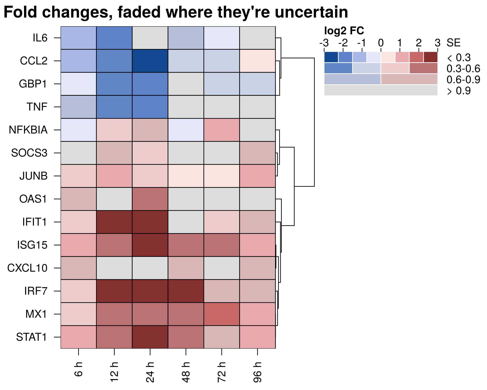
```

#### 2.3.2 Two Values in Each Cell

To compare two conditions cell by cell, such as control and stimulated samples or two time points, `cell_split` takes a second matrix with the same dimensions as the data. Each cell is split along its diagonal: the value in `x` fills the upper left half and the value in `cell_split` the lower right half, on the same colour scale, whose limits cover both. Changes then show up as cells with two colours, without doubling the size of the heatmap. `cell_split_labels` names the two halves in the legend.

```{r, eval = FALSE}
set.seed(6)
types <- c("B", "CD4 T", "CD8 T", "NK", "Mono", "DC")
genes <- c("IFNG", "GZMB", "PRF1", "TNF", "IL2RA", "CD69", "HLA-DR",
           "CD86", "IL10", "CXCL8")
# Expression in each cell type before and after stimulation
control <- matrix(rnorm(60, 0, 0.6), 10, dimnames = list(genes, types))
stimulated <- control + matrix(rnorm(60, 0, 0.3), 10)
stimulated["IFNG", c("CD4 T", "CD8 T", "NK")] <-
  stimulated["IFNG", c("CD4 T", "CD8 T", "NK")] + c(1.8, 2.6, 2.9)
stimulated["GZMB", c("CD8 T", "NK")] <- stimulated["GZMB", c("CD8 T", "NK")] + 2.2
stimulated["CD69", ] <- stimulated["CD69", ] + 1.4
stimulated["IL10", "Mono"] <- stimulated["IL10", "Mono"] + 2.4
stimulated["CD86", c("Mono", "DC")] <- stimulated["CD86", c("Mono", "DC")] + 1.6
heat_map(
  control,
  cell_split = stimulated,
  cell_split_labels = c("Control", "Stimulated"),
  tree_y = TRUE,
  legend_title = "Expression",
  title = "Control and stimulated in each cell"
)
```

```{r, eval = FALSE, echo = FALSE}
set.seed(6)
types <- c("B", "CD4 T", "CD8 T", "NK", "Mono", "DC")
genes <- c("IFNG", "GZMB", "PRF1", "TNF", "IL2RA", "CD69", "HLA-DR",
           "CD86", "IL10", "CXCL8")
# Expression in each cell type before and after stimulation
control <- matrix(rnorm(60, 0, 0.6), 10, dimnames = list(genes, types))
stimulated <- control + matrix(rnorm(60, 0, 0.3), 10)
stimulated["IFNG", c("CD4 T", "CD8 T", "NK")] <-
  stimulated["IFNG", c("CD4 T", "CD8 T", "NK")] + c(1.8, 2.6, 2.9)
stimulated["GZMB", c("CD8 T", "NK")] <- stimulated["GZMB", c("CD8 T", "NK")] + 2.2
stimulated["CD69", ] <- stimulated["CD69", ] + 1.4
stimulated["IL10", "Mono"] <- stimulated["IL10", "Mono"] + 2.4
stimulated["CD86", c("Mono", "DC")] <- stimulated["CD86", c("Mono", "DC")] + 1.6
heat_map_save(
  "vignettes/HeatmapR/HeatmapR-split.png",
  height = 6,
  width = 7,
  res = 300
)
heat_map(
  control,
  cell_split = stimulated,
  cell_split_labels = c("Control", "Stimulated"),
  tree_y = TRUE,
  legend_title = "Expression",
  title = "Control and stimulated in each cell"
)
```

```{r echo = FALSE, out.width = '95%', fig.align="center"}
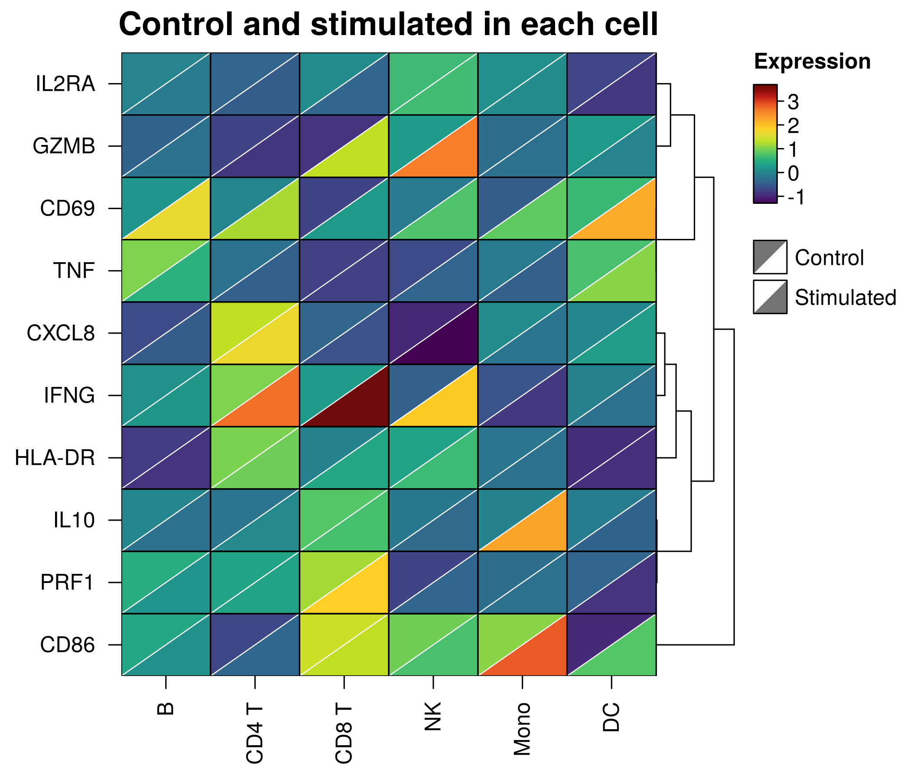
```

Split cells need full-size rectangles, so `cell_size` and other `cell_shape`s can't be used with them.

### 2.4 Cell Borders

The borders of every cell within the constructed heatmap can also be customised using the `cell_border_line_type`, `cell_border_line_width`, `cell_border_line_col` and `cell_border_line_col_alpha` arguments.

```{r, eval = FALSE}
heat_map(
  mtcars,
  cell_border_line_type = 3,
  cell_border_line_width = 2,
  cell_border_line_col = "red",
  cell_border_line_col_alpha = 1
)
```

```{r, eval = FALSE, echo = FALSE}
heat_map_save(
  "vignettes/HeatmapR/HeatmapR-6.png",
  height = 11,
  width = 7,
  res = 500
)
heat_map(
  mtcars,
  cell_border_line_type = 3,
  cell_border_line_width = 2,
  cell_border_line_col = "red",
  cell_border_line_col_alpha = 1
)
```

```{r echo = FALSE, out.width = '95%', fig.align="center"}
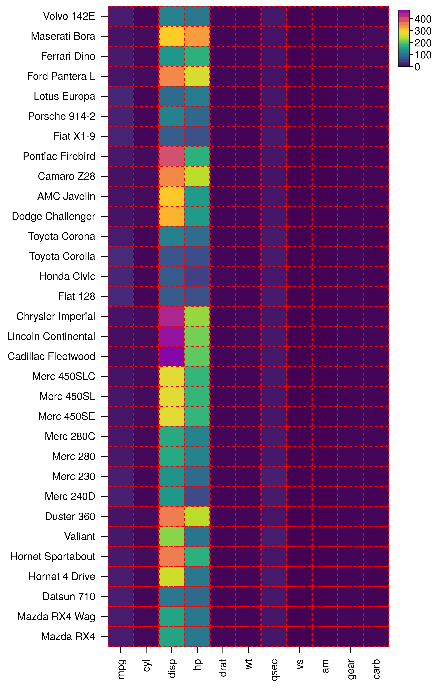
```

#### 2.4.1 Border Masking

The `cell_border_mask` argument allows you to selectively apply colored borders to specific cells by supplying a logical matrix of the same dimensions as the input data. Cells with `TRUE` values will display colored borders, while cells with `FALSE` values will have transparent borders. This is particularly useful for highlighting specific patterns or regions of interest within a heatmap.

```{r, eval = FALSE}
# Create a mask to highlight high values
border_mask <- mtcars > median(unlist(mtcars))

heat_map(
  mtcars,
  cell_border_line_width = 2,
  cell_border_line_col = "red",
  cell_border_mask = border_mask,
  title = "Border Masking Example"
)
```

```{r, eval = FALSE, echo = FALSE}
heat_map_save(
  "vignettes/HeatmapR/HeatmapR-6b.png",
  height = 11,
  width = 7,
  res = 500
)
# Create a mask to highlight high values
border_mask <- mtcars > median(unlist(mtcars))

heat_map(
  mtcars,
  cell_border_line_width = 2,
  cell_border_line_col = "red",
  cell_border_mask = border_mask,
  title = "Border Masking Example",
  cell_text = TRUE
)
```

```{r echo = FALSE, out.width = '95%', fig.align="center"}
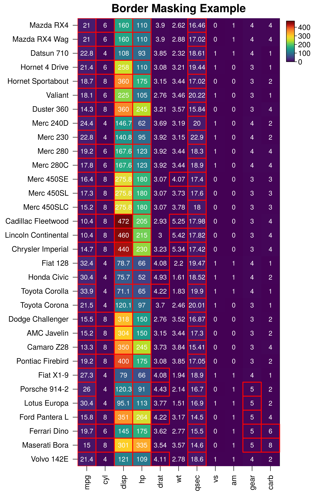
```

### 2.5 Cell Text

The values of every cells within the constructed heatmap can be displayed by setting `cell_text = TRUE`. By default, numeric values are rounded to two decimal places but this can be changed through the `round` argument. The text displayed in each cell can easily be customised using the `cell_text_size`, `cell_text_font`, `cell_text_col` and `cell_text_col_alpha` arguments. 

```{r, eval = FALSE}
heat_map(
  mtcars,
  cell_text = TRUE,
  cell_text_size = 1,
  cell_text_font = 2,
  cell_text_col = "black",
  cell_text_col_alpha = 1,
  title = "mtcars"
)
```

```{r, eval = FALSE, echo = FALSE}
heat_map_save(
  "vignettes/HeatmapR/HeatmapR-7.png",
  height = 11,
  width = 8,
  res = 500
)
heat_map(
  mtcars,
  cell_text = TRUE,
  cell_text_size = 1,
  cell_text_font = 2,
  cell_text_col = "black",
  cell_text_col_alpha = 1,
  cell_col_alpha = 0.9,
  title = "mtcars"
)
```

```{r echo = FALSE, out.width = '95%', fig.align="center"}
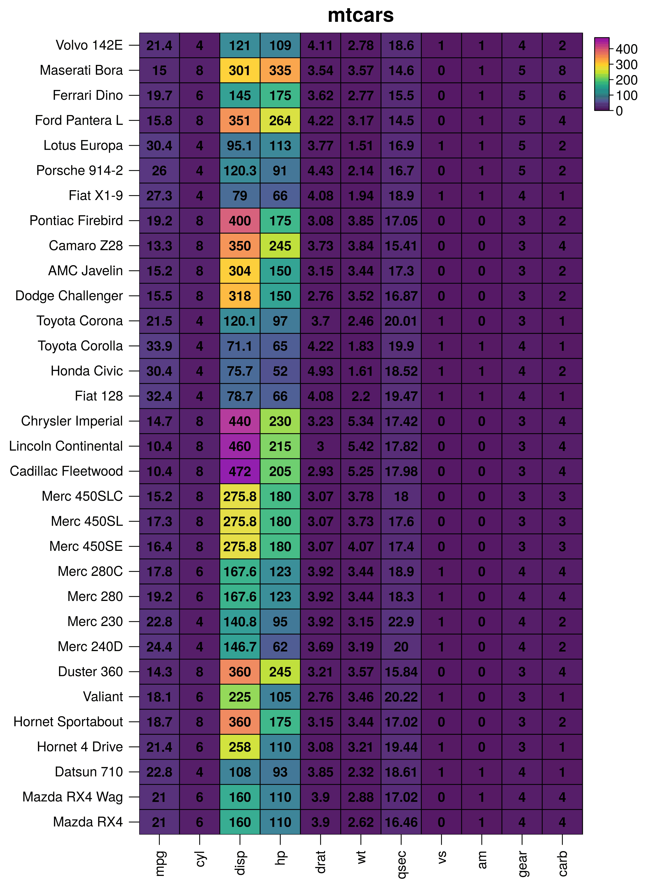
```

### 2.6 Large Heatmaps

Heatmaps with more than 50,000 cells, such as single-cell data with thousands of cells and tens of markers, are drawn as raster images rather than one rectangle per cell. Raster images draw a 1000 x 1000 heatmap about three times faster and give PDFs about a quarter of the size, and look the same as the rectangles. Raster images are only used when every cell is a full-size rectangle; `cell_raster = TRUE` uses them for smaller heatmaps too and `cell_raster = FALSE` turns them off. Cell borders are left out when the cells are smaller than three line widths, as they would otherwise hide the cells.

```{r, eval = FALSE}
set.seed(1)
cells <- matrix(
  rnorm(5000 * 20),
  nrow = 5000,
  dimnames = list(
    NULL,
    paste0("Marker_", 1:20)
  )
)
cells[1:1500, 1:8] <- cells[1:1500, 1:8] + 2.5
cells[3001:5000, 12:20] <- cells[3001:5000, 12:20] + 2
heat_map(
  cells,
  tree_x = TRUE,
  tree_cut_y = 3,
  tree_label_y = TRUE,
  tree_label_text_y = c("A", "B", "C"),
  axis_text_y = NA,
  title = "5000 cells"
)
```

```{r, eval = FALSE, echo = FALSE}
set.seed(1)
cells <- matrix(
  rnorm(5000 * 20),
  nrow = 5000,
  dimnames = list(
    NULL,
    paste0("Marker_", 1:20)
  )
)
cells[1:1500, 1:8] <- cells[1:1500, 1:8] + 2.5
cells[3001:5000, 12:20] <- cells[3001:5000, 12:20] + 2
heat_map_save(
  "vignettes/HeatmapR/HeatmapR-raster.png",
  height = 8,
  width = 7,
  res = 300
)
heat_map(
  cells,
  tree_x = TRUE,
  tree_cut_y = 3,
  tree_label_y = TRUE,
  tree_label_text_y = c("A", "B", "C"),
  axis_text_y = NA,
  title = "5000 cells"
)
```

```{r echo = FALSE, out.width = '95%', fig.align="center"}
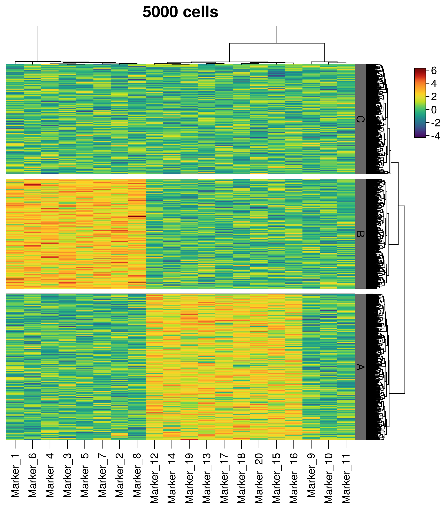
```

Clustering is the slow part of a large heatmap. It needs the distance between every pair of rows, so exact clustering of 10,000 rows takes about 3 seconds and 400 MB of memory, and four times as much for twice the rows. Rows (or columns) beyond `clust_max`, 5000 by default, are clustered in two stages instead. A sample of 5000 rows is clustered exactly and its dendrogram is split into groups of about 200 rows, every row joins the group whose medoid it is closest to, and each group is clustered on its own beneath the sample's dendrogram. The sample is drawn with a fixed seed, so the dendrogram is the same each time. The dendrogram shows the structure of the data down to the groups and within each group, and 100,000 rows take about 2 seconds. `clust_max = Inf` always clusters exactly, and `heat_map_clust()` takes the same limit as `max`. Branch support is only computed for up to `clust_max` rows or columns, and optimal leaf ordering (`tree_order_y = "olo"`) of more than 2000 rows orders blocks of the dendrogram. Distances, linkage and leaf ordering run in compiled C++ code.

```{r, eval = FALSE}
set.seed(1)
cells <- matrix(
  rnorm(100000 * 20),
  nrow = 100000,
  dimnames = list(
    NULL,
    paste0("Marker_", 1:20)
  )
)
cells[1:30000, 1:8] <- cells[1:30000, 1:8] + 2.5
cells[60001:100000, 12:20] <- cells[60001:100000, 12:20] + 2
heat_map(
  cells,
  tree = "both",
  tree_cut_y = 3,
  axis_text_y = NA,
  title = "100,000 cells"
)
```

### 2.7 Labelling Chosen Rows and Columns

When a heatmap has too many rows to label them all, `mark_y` (and `mark_x` for columns) labels just the rows you choose, given as names, positions in the heatmap (rows from the top) or a logical vector in the order of the data. The labels replace the axis text: they are spread out beside the heatmap so that they don't overlap, and leader lines connect each label to its row. `mark_labels_y` supplies other text for the labels (e.g. gene symbols), and `mark_line_col` sets the colour of the leader lines.

```{r, eval = FALSE}
set.seed(2)
genes <- matrix(
  rnorm(2000 * 24),
  nrow = 2000,
  dimnames = list(
    paste0("Gene_", 1:2000),
    paste0("S", 1:24)
  )
)
genes[1:150, 1:12] <- genes[1:150, 1:12] + 2.5
genes[1001:1150, 13:24] <- genes[1001:1150, 13:24] + 2.5
heat_map(
  genes,
  tree_x = TRUE,
  tree_cut_y = 2,
  mark_y = c("Gene_3", "Gene_42", "Gene_77", "Gene_150", "Gene_1010", "Gene_1100", "Gene_1500"),
  mark_labels_y = c("CD3E", "CD4", "IL7R", "CCR7", "MS4A1", "CD79A", "ACTB"),
  title = "Marker genes"
)
```

```{r, eval = FALSE, echo = FALSE}
heat_map_save(
  "vignettes/HeatmapR/HeatmapR-marks.png",
  height = 8,
  width = 7,
  res = 300
)
set.seed(2)
genes <- matrix(
  rnorm(2000 * 24),
  nrow = 2000,
  dimnames = list(
    paste0("Gene_", 1:2000),
    paste0("S", 1:24)
  )
)
genes[1:150, 1:12] <- genes[1:150, 1:12] + 2.5
genes[1001:1150, 13:24] <- genes[1001:1150, 13:24] + 2.5
heat_map(
  genes,
  tree_x = TRUE,
  tree_cut_y = 2,
  mark_y = c("Gene_3", "Gene_42", "Gene_77", "Gene_150", "Gene_1010", "Gene_1100", "Gene_1500"),
  mark_labels_y = c("CD3E", "CD4", "IL7R", "CCR7", "MS4A1", "CD79A", "ACTB"),
  title = "Marker genes"
)
```

```{r echo = FALSE, out.width = '95%', fig.align="center"}
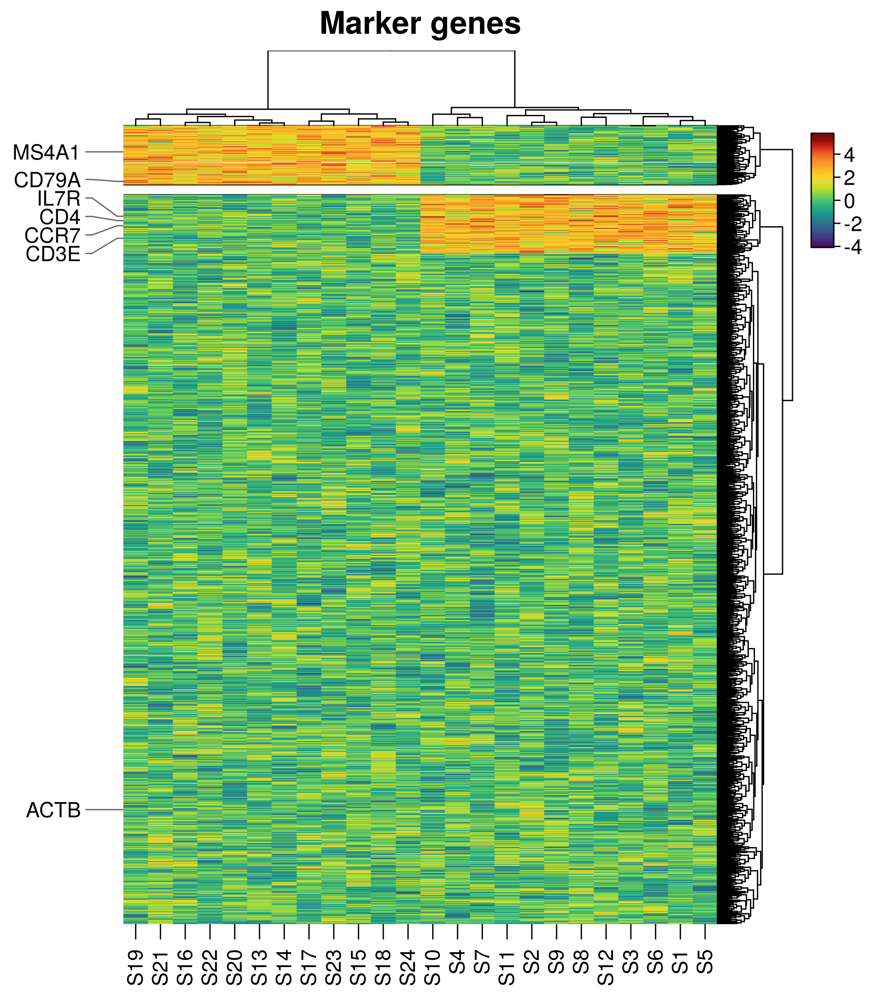
```

#### 2.7.1 Zooming Into a Band of Rows

Mark labels name a few rows, but they don't show their values. `zoom_y` (and `zoom_x` for columns) enlarges a band of rows in a panel beside the heatmap instead, so the detail of a few rows can be read together with the whole. The band runs from the first to the last of the rows you choose in the displayed order (giving the first and last rows is enough), is outlined on the heatmap and joined to the panel by a wedge. The panel sits on the axis text side and is labelled with the names of the enlarged rows, in place of the axis text. `zoom_size_y` sets the width of the panel relative to the heatmap (the same width by default), and enlarged rows are at most 0.3 inches tall.

```{r, eval = FALSE}
set.seed(2)
genes <- matrix(
  rnorm(2000 * 24),
  nrow = 2000,
  dimnames = list(
    paste0("Gene_", 1:2000),
    paste0("S", 1:24)
  )
)
genes[1:150, 1:12] <- genes[1:150, 1:12] + 2.5
genes[1001:1150, 13:24] <- genes[1001:1150, 13:24] + 2.5
# 20 genes of a pathway - up in half of each group of samples
genes[151:170, c(1:6, 13:18)] <- genes[151:170, c(1:6, 13:18)] + 3
rownames(genes)[151:170] <- c(
  "IL7R", "CCR7", "SELL", "LEF1", "TCF7", "CD27", "CD28", "KLF2", "S1PR1",
  "FOXP1", "BACH2", "SATB1", "PLAC8", "LTB", "MAL", "NOSIP", "PIK3IP1",
  "TXK", "AQP3", "CD7"
)
heat_map(
  genes,
  scale = "row",
  tree_x = TRUE,
  zoom_y = c("IL7R", "CD7"),
  title = "A pathway in 2,000 genes"
)
```

```{r, eval = FALSE, echo = FALSE}
heat_map_save(
  "vignettes/HeatmapR/HeatmapR-zoom.png",
  height = 6.5,
  width = 9,
  res = 300
)
set.seed(2)
genes <- matrix(
  rnorm(2000 * 24),
  nrow = 2000,
  dimnames = list(
    paste0("Gene_", 1:2000),
    paste0("S", 1:24)
  )
)
genes[1:150, 1:12] <- genes[1:150, 1:12] + 2.5
genes[1001:1150, 13:24] <- genes[1001:1150, 13:24] + 2.5
# 20 genes of a pathway - up in half of each group of samples
genes[151:170, c(1:6, 13:18)] <- genes[151:170, c(1:6, 13:18)] + 3
rownames(genes)[151:170] <- c(
  "IL7R", "CCR7", "SELL", "LEF1", "TCF7", "CD27", "CD28", "KLF2", "S1PR1",
  "FOXP1", "BACH2", "SATB1", "PLAC8", "LTB", "MAL", "NOSIP", "PIK3IP1",
  "TXK", "AQP3", "CD7"
)
heat_map(
  genes,
  scale = "row",
  tree_x = TRUE,
  zoom_y = c("IL7R", "CD7"),
  title = "A pathway in 2,000 genes"
)
```

```{r echo = FALSE, out.width = '95%', fig.align="center"}
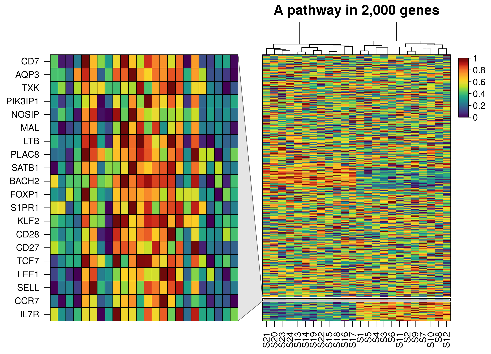
```

The panel keeps the cells' shapes, text and distributions and the gaps between clusters. Rows that are far apart in a clustered heatmap make a wide band; to enlarge one cluster, pass its rows, e.g. `zoom_y = heat_map_info(hm)$row_clusters == 2`.

### 2.8 Rotated Column Labels

Long column names are easier to read at an angle. As well as the `las` codes 0 to 3 (3, perpendicular to the axis, by default), `axis_text_angle_x` takes an angle in degrees. Rotated labels end at their ticks and slant towards the y axis text, so the longest labels extend beneath the row names rather than into the dendrograms or the legend. They are only shrunk when neighbouring labels would overlap across their baselines, so they stay larger than perpendicular labels on crowded heatmaps.

```{r, eval = FALSE}
heat_map(
  t(scale(mtcars)),
  tree = "both",
  axis_text_angle_x = 45
)
```

```{r, eval = FALSE, echo = FALSE}
heat_map_save(
  "vignettes/HeatmapR/HeatmapR-rotate.png",
  height = 7,
  width = 9,
  res = 300
)
heat_map(
  t(scale(mtcars)),
  tree = "both",
  axis_text_angle_x = 45
)
```

```{r echo = FALSE, out.width = '95%', fig.align="center"}
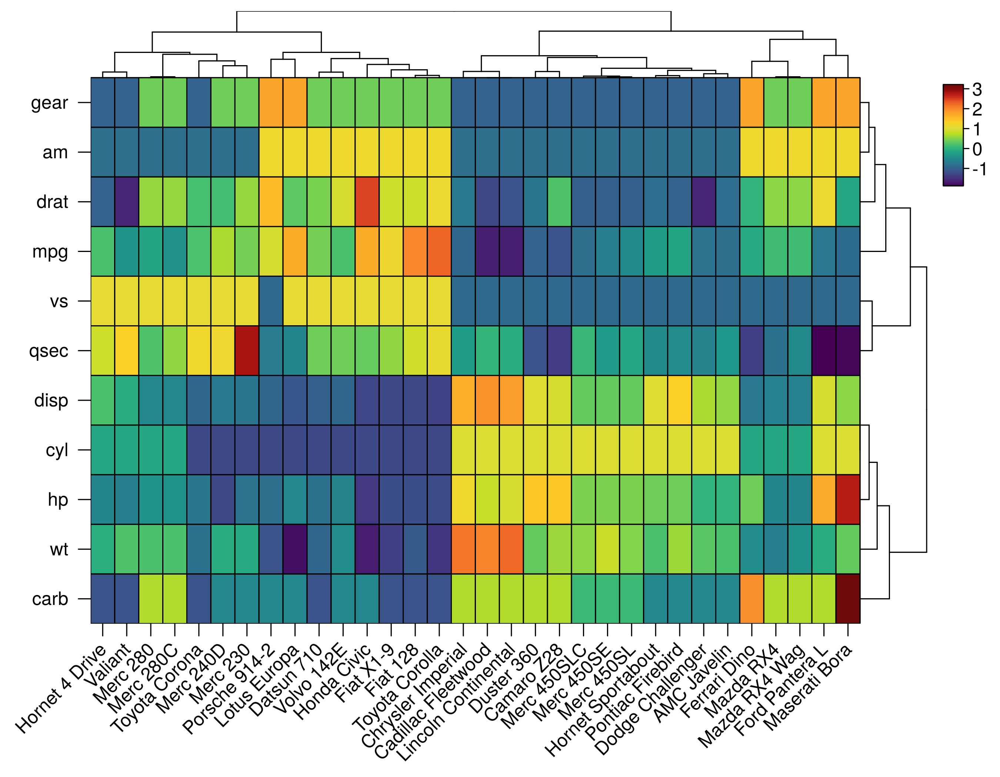
```

### 2.9 Correlation Matrices {#correlation-matrices}

`heat_map_cor()` draws the correlations between the columns of a data set (or a correlation matrix) with one order for the rows and columns, so that the diagonal runs from the top left to the bottom right and each triangle can show the correlations differently. By default, the variables are clustered on one minus their correlations, the lower triangle shows ellipses, the upper triangle the correlation coefficients written in their colours, and the diagonal the names of the variables. Each ellipse is the outline of a bivariate normal distribution with that correlation: a circle for uncorrelated variables, rising to the right for positive correlations, falling for negative ones, and narrower the stronger the correlation.

```{r, eval = FALSE}
heat_map_cor(mtcars)
```

```{r, eval = FALSE, echo = FALSE}
heat_map_save(
  "vignettes/HeatmapR/HeatmapR-cor.png",
  height = 6.5,
  width = 7.5,
  res = 300
)
heat_map_cor(mtcars)
```

```{r echo = FALSE, out.width = '95%', fig.align="center", fig.alt = "Correlation heatmap of the mtcars variables, clustered so that correlated variables sit together, with ellipses in the lower triangle, the coefficients written in blue (negative) or red (positive) in the upper triangle and the variable names on the diagonal."}
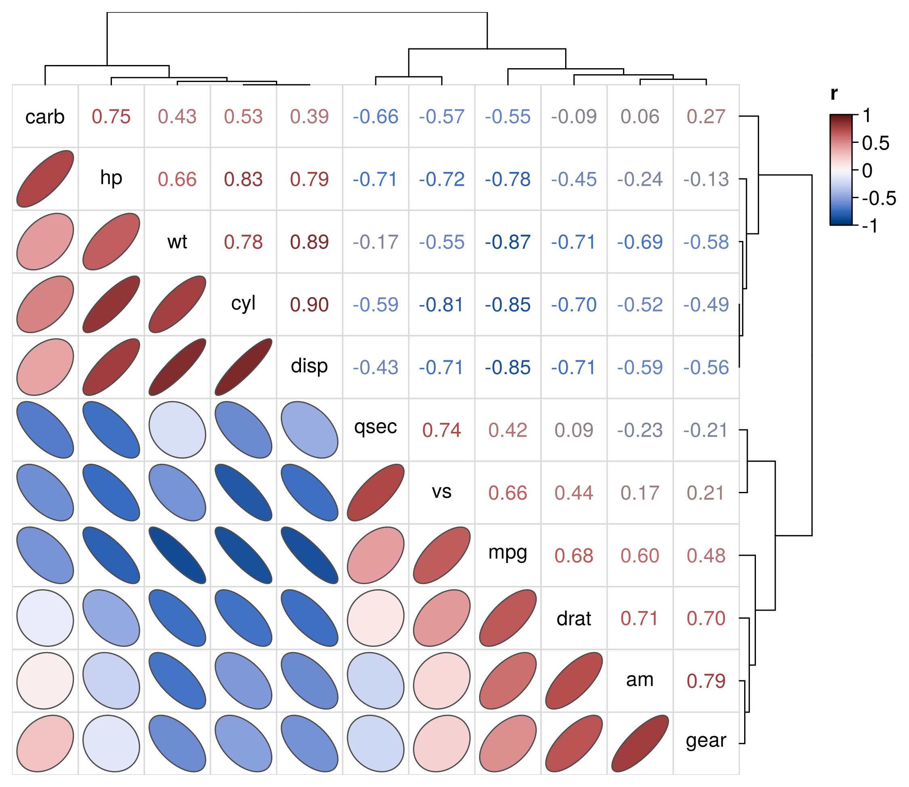
```

`lower`, `upper` and `diag` take any cell shape - `"circle"` and `"diamond"` are sized by the absolute correlation, and `"none"` leaves a triangle empty - and any other `heat_map()` argument can be added, such as cuts that split the variables into clusters along both axes:

```{r, eval = FALSE}
heat_map_cor(
  mtcars,
  method = "spearman",
  upper = "ellipse",
  tree_cut_x = 3,
  tree_cut_y = 3
)
```

```{r, eval = FALSE, echo = FALSE}
heat_map_save(
  "vignettes/HeatmapR/HeatmapR-cor-2.png",
  height = 6.5,
  width = 7.5,
  res = 300
)
heat_map_cor(
  mtcars,
  method = "spearman",
  upper = "ellipse",
  tree_cut_x = 3,
  tree_cut_y = 3
)
```

```{r echo = FALSE, out.width = '95%', fig.align="center", fig.alt = "Spearman correlations of the mtcars variables drawn as ellipses throughout, with the variables split into three clusters along both axes."}
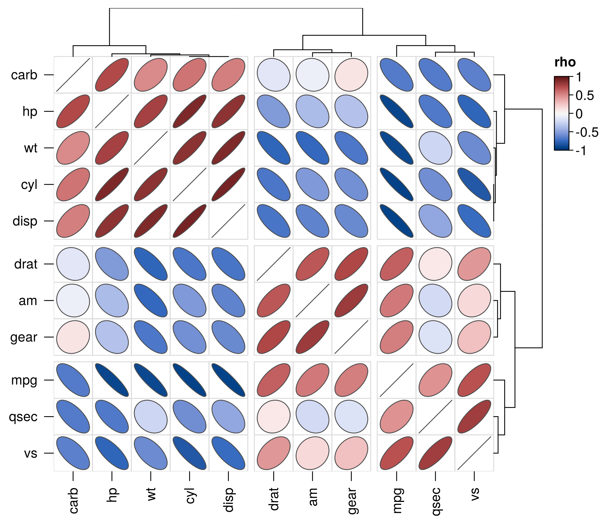
```

For other layouts, the shapes can be set cell by cell in `heat_map()` with a matrix of shapes, e.g. ellipses for the correlations of each gene with a set of clinical variables and numbers for the strongest ones.

## 3. Data Scaling

In the above heatmap, it is very clear that each of the columns of the input matrix are on completely different scales, making it difficult to visualise differences in columns with very small values. In order to represent each column on the same scale, we can apply a form of data scaling through the `scale_method` argument either to each row or column as specified by the `scale` argument. Currently, `heat_map()` has internal support for `"mean"`, `"range"` and `"z-score"` scaling methods that can be applied to either the rows or columns of the input matrix.

### 3.1 Scaling Columns

To scale the values in every column, simply set `scale = "column` and specify the scaling method through the `scale_method` argument. For example, to apply range scaling to every column in the `mtcars` dataset:

```{r, eval = FALSE}
heat_map(
  mtcars,
  scale = "column",
  scale_method = "range",
  title = "mtcars scaled columns"
)
```

```{r, eval = FALSE, echo = FALSE}
heat_map_save(
  "vignettes/HeatmapR/HeatmapR-8.png",
  height = 11,
  width = 8,
  res = 500
)
heat_map(
  mtcars,
  scale = "column",
  scale_method = "range",
  title = "mtcars scaled columns"
)
```

```{r echo = FALSE, out.width = '95%', fig.align="center"}
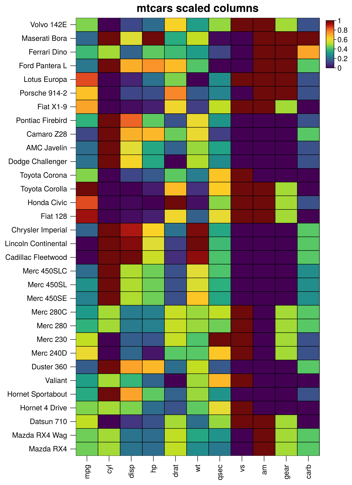
```

### 3.2 Scaling Rows

Similarly, in instances where it is more appropriate to scale the values in each row, we can set `scale = "row"` and pass the required scaling method to `scale_method`. For example, to apply z-score scaling to every row in the `mtcars` dataset:

```{r, eval = FALSE}
heat_map(
  mtcars,
  scale = "row",
  scale_method = "zscore",
  title = "mtcars scaled rows"
)
```

```{r, eval = FALSE, echo = FALSE}
heat_map_save(
  "vignettes/HeatmapR/HeatmapR-9.png",
  height = 11,
  width = 8,
  res = 500
)
heat_map(
  mtcars,
  scale = "row",
  scale_method = "zscore",
  title = "mtcars scaled rows"
)
```

```{r echo = FALSE, out.width = '95%', fig.align="center"}
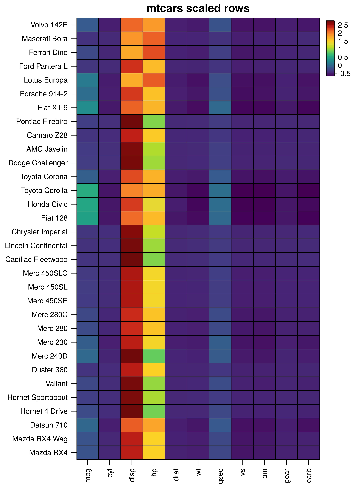
```

## 4. Bar Plots

In addition to the cells of the heatmap, `heat_map()` supports the display of additional values in bar plots on either axis of the heatmap. To add bar plots to the heatmap, users should supply the (named) values to `bar_values_x` and/or `bar_values_y` in the same order as the original input matrix. The bar plots will be displayed on the opposite side to the axis text and size of the bar plot (i.e. height or width) can be controlled through the `bar_size_x` and `bar_size_y` arguments. The colours of the bars and borders can be customised using the `bar_fill_` and `bar_line_` family of arguments. In the example below, we demonstrate the addition of bar plots to the x and y axes of a heatmap constructed using the `mtcars` dataset:

```{r, eval = FALSE}
heat_map(
  mtcars,
  bar_values_x = 1:ncol(mtcars),
  bar_size_x = 1.5,
  bar_fill_x = rainbow(ncol(mtcars)),
  bar_line_col_x = "black",
  bar_values_y = 1:nrow(mtcars),
  bar_size_y = 0.8,
  bar_fill_y = rainbow(ncol(mtcars)),
  bar_line_col_y = "black",
  title = "heatmap with bar plots"
)
```

```{r, eval = FALSE, echo = FALSE}
heat_map_save(
  "vignettes/HeatmapR/HeatmapR-10.png",
  height = 11,
  width = 8,
  res = 500
)
heat_map(
  mtcars,
  bar_values_x = 1:ncol(mtcars),
  bar_size_x = 1.5,
  bar_fill_x = rainbow(ncol(mtcars)),
  bar_line_col_x = "black",
  bar_values_y = 1:nrow(mtcars),
  bar_size_y = 0.8,
  bar_fill_y = rainbow(nrow(mtcars)),
  bar_line_col_y = "black",
  title = "heatmap with bar plots"
)
```

```{r echo = FALSE, out.width = '95%', fig.align="center"}
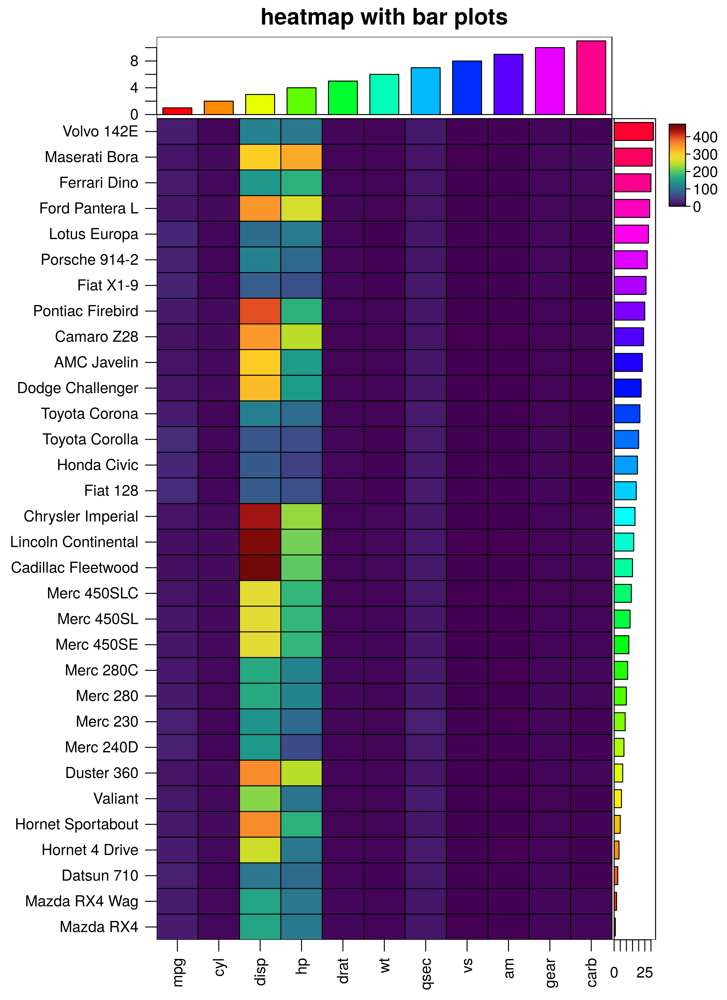
```

### 4.1 Metadata Annotations

Metadata describing the rows or columns of the heatmap, such as the treatment and sex of each sample, can be shown as coloured tracks beside the heatmap. Supply a `data.frame` with one row per column of `x` to `annotation_x` (or one row per row of `x` to `annotation_y`). Rows are matched to the column (row) names of `x` when the `data.frame` has row names. Each column of the `data.frame` becomes a track: non-numeric columns are coloured by level and numeric columns with a colour ramp, and each track gets its own legend. Colours can be chosen through `annotation_colours`, a named list with one entry per annotation; annotations without an entry get default palettes.

Annotations combine well with manual clustering: supplying a factor to `tree_cut_x` splits the columns into groups and, when `tree_label_x = TRUE`, labels each group with its level.

```{r, eval = FALSE}
set.seed(123)
mat <- matrix(
  rnorm(20 * 24, sd = 1.5),
  nrow = 20,
  ncol = 24,
  dimnames = list(
    paste0("Gene_", 1:20),
    paste0("S", sprintf("%02d", 1:24))
  )
)
meta <- data.frame(
  Treatment = factor(rep(c("Control", "Drug_A", "Drug_B"), each = 8)),
  Sex = factor(rep(c("Male", "Female"), times = 12), levels = c("Male", "Female")),
  row.names = colnames(mat)
)
heat_map(
  mat,
  annotation_x = meta,
  annotation_colours = list(
    Treatment = c(Control = "#4E9FD1", Drug_A = "#E07B54", Drug_B = "#6DBF7E"),
    Sex = c(Male = "#7B5EA7", Female = "#E8A0BF")
  ),
  tree_cut_x = meta$Treatment,
  tree_label_x = TRUE,
  tree_y = TRUE,
  cell_col_scale = c("#2C7BB6", "white", "#D7191C"),
  cell_col_scale_center = 0,
  legend_title = "z-score",
  title = "Metadata annotations"
)
```

```{r, eval = FALSE, echo = FALSE}
heat_map_save(
  "vignettes/HeatmapR/HeatmapR-annotations.png",
  height = 7,
  width = 9,
  res = 300
)
set.seed(123)
mat <- matrix(
  rnorm(20 * 24, sd = 1.5),
  nrow = 20,
  ncol = 24,
  dimnames = list(
    paste0("Gene_", 1:20),
    paste0("S", sprintf("%02d", 1:24))
  )
)
meta <- data.frame(
  Treatment = factor(rep(c("Control", "Drug_A", "Drug_B"), each = 8)),
  Sex = factor(rep(c("Male", "Female"), times = 12), levels = c("Male", "Female")),
  row.names = colnames(mat)
)
heat_map(
  mat,
  annotation_x = meta,
  annotation_colours = list(
    Treatment = c(Control = "#4E9FD1", Drug_A = "#E07B54", Drug_B = "#6DBF7E"),
    Sex = c(Male = "#7B5EA7", Female = "#E8A0BF")
  ),
  tree_cut_x = meta$Treatment,
  tree_label_x = TRUE,
  tree_y = TRUE,
  cell_col_scale = c("#2C7BB6", "white", "#D7191C"),
  cell_col_scale_center = 0,
  legend_title = "z-score",
  title = "Metadata annotations"
)
```

```{r echo = FALSE, out.width = '95%', fig.align="center"}
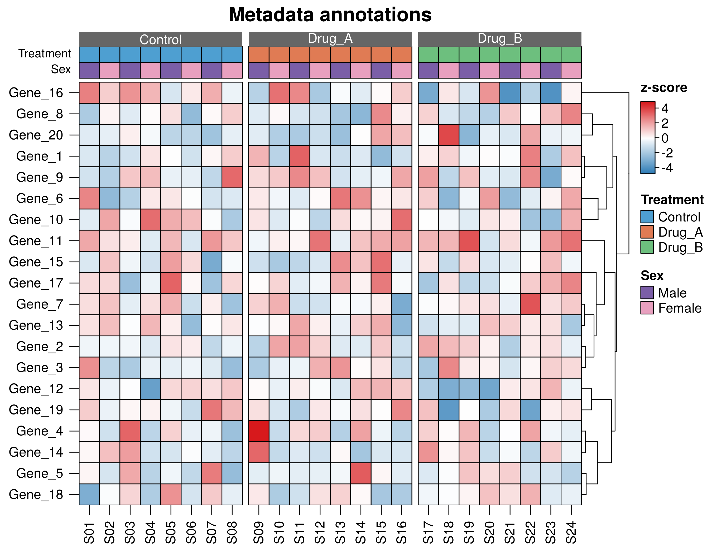
```

### 4.2 Box Plots and Violins

The bar plots can also show the distribution of several values for each column or row, as box plots (`bar_type_x = "box"`) or violins (`bar_type_x = "violin"`). Supply a list with a numeric vector for each column (or row), a matrix or data.frame with one column per column of the heatmap (one row per row for `bar_values_y`), or `TRUE` to show the values of each column or row of the heatmap itself. Box plots are drawn by default when distributions are supplied. In the example below, the heatmap shows the median intensity of each marker in each cluster of simulated cytometry events (computed with `heat_map_summarise()`, see section 5.3), the violins show the distribution of each marker across all events, and the bars show the size of each cluster:

```{r, eval = FALSE}
set.seed(7)
markers <- c("CD3", "CD4", "CD8", "CD19", "CD56", "CD14")
pops <- list(
  "CD4 T" = c("CD3", "CD4"),
  "CD8 T" = c("CD3", "CD8"),
  "B" = "CD19",
  "NK" = "CD56",
  "Monocyte" = c("CD4", "CD14")
)
cluster <- sample(
  names(pops),
  5000,
  replace = TRUE,
  prob = c(0.35, 0.2, 0.15, 0.1, 0.2)
)
events <- matrix(
  rnorm(5000 * 6, 0.5, 0.5),
  ncol = 6,
  dimnames = list(NULL, markers)
)
for (p in names(pops)) {
  ind <- cluster == p
  events[ind, pops[[p]]] <- rnorm(sum(ind) * length(pops[[p]]), 4, 0.6)
}
heat_map(
  heat_map_summarise(events, group_y = cluster, fun = "median"),
  cell_col_scale = "viridis",
  bar_values_x = events,
  bar_type_x = "violin",
  bar_size_x = 2,
  bar_fill_x = "grey85",
  bar_axis_label_x = "All events",
  bar_values_y = table(cluster),
  bar_fill_y = "grey85",
  bar_axis_label_y = "Events",
  title = "Median marker intensity per cluster"
)
```

```{r, eval = FALSE, echo = FALSE}
set.seed(7)
markers <- c("CD3", "CD4", "CD8", "CD19", "CD56", "CD14")
pops <- list(
  "CD4 T" = c("CD3", "CD4"),
  "CD8 T" = c("CD3", "CD8"),
  "B" = "CD19",
  "NK" = "CD56",
  "Monocyte" = c("CD4", "CD14")
)
cluster <- sample(
  names(pops),
  5000,
  replace = TRUE,
  prob = c(0.35, 0.2, 0.15, 0.1, 0.2)
)
events <- matrix(
  rnorm(5000 * 6, 0.5, 0.5),
  ncol = 6,
  dimnames = list(NULL, markers)
)
for (p in names(pops)) {
  ind <- cluster == p
  events[ind, pops[[p]]] <- rnorm(sum(ind) * length(pops[[p]]), 4, 0.6)
}
heat_map_save(
  "vignettes/HeatmapR/HeatmapR-side-plots.png",
  height = 6,
  width = 7,
  res = 300
)
heat_map(
  heat_map_summarise(events, group_y = cluster, fun = "median"),
  cell_col_scale = "viridis",
  bar_values_x = events,
  bar_type_x = "violin",
  bar_size_x = 2,
  bar_fill_x = "grey85",
  bar_axis_label_x = "All events",
  bar_values_y = table(cluster),
  bar_fill_y = "grey85",
  bar_axis_label_y = "Events",
  title = "Median marker intensity per cluster"
)
```

```{r echo = FALSE, out.width = '95%', fig.align="center"}
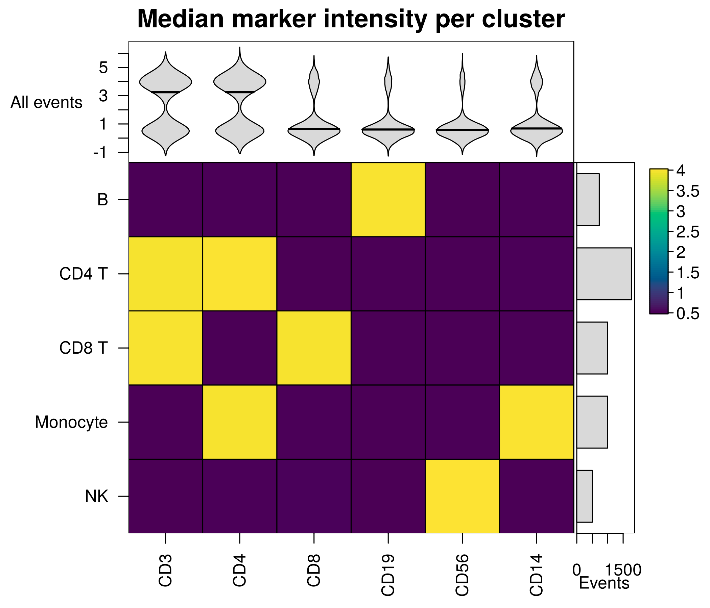
```

## 5. Hierarchical Clustering

`heat_map()` also supports hierarchical clustering using the conventional `stats::hclust()` to construct dendrograms and `stats::cutree()` to partition the dendrograms into distinct clusters. The `dist_method` and `clust_method` arguments allow for control over the distance metric to use for hierarchical clustering (any method supported by `stats::dist()`, `"cosine"` for cosine distance, `"pearson"`, `"spearman"` or `"kendall"` for correlation distances, or a function) and the agglomeration method to use (any method supported by `stats::hclust()`).

### 5.1 Dendrograms

Dendrograms can be added to the x and/or y axis using the `tree`, `tree_x` or `tree_y` arguments. The `tree` argument indicates whether dendrograms should be drawn for the `"x"`, `"y"` or `"both"` axes. Alternatively, the `tree_x` or `tree_y` arguments can be set to `TRUE` to include dendrograms on the x or y axes respectively. The `tree_x` and `tree_y` arguments also accept objects of class `dist` or `hclust` to allow for custom dendrograms using unsupported distance metrics or agglomeration methods. The `tree_size_x` and `tree_size_y` arguments are scalars to control the height or width of the dendrograms on the x and y axes respectively. The `tree_scale_x` and `tree_scale_y` arguments can be used to scale the branch heights of the dendrogram to be the same height at each level allowing for better visualisation of relationships in large heatmaps.

```{r, eval = FALSE}
heat_map(
  mtcars,
  scale = "column",
  dist_method = "euclidean",
  clust_method = "complete",
  tree_x = TRUE,
  tree_y = TRUE,
  tree_size_y = 0.8,
  title = "Dendrograms"
)
```

```{r, eval = FALSE, echo = FALSE}
heat_map_save(
  "vignettes/HeatmapR/HeatmapR-11.png",
  height = 11,
  width = 8,
  res = 500
)
heat_map(
  mtcars,
  scale = "column",
  dist_method = "euclidean",
  clust_method = "complete",
  tree_x = TRUE,
  tree_scale_x = TRUE,
  tree_y = TRUE,
  tree_size_y = 0.8,
  title = "Dendrograms"
)
```

```{r echo = FALSE, out.width = '95%', fig.align="center"}
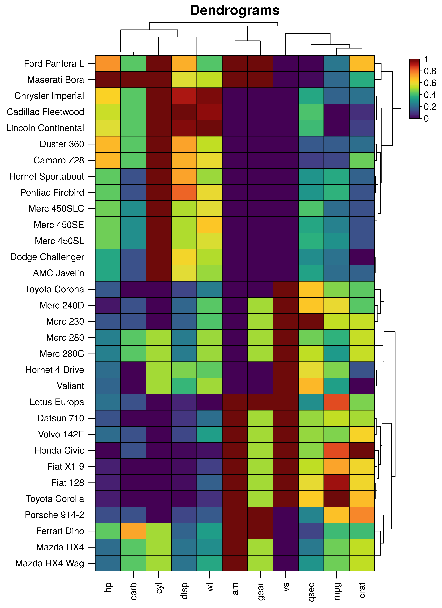
```

#### 5.1.1 Cosine Distance

In addition to the standard distance metrics supported by `stats::dist()`, **HeatmapR** also supports cosine distance for hierarchical clustering. Cosine distance (1 - cosine similarity) measures the angle between vectors and is particularly useful for high-dimensional data where the magnitude of the vectors is less important than their direction. This is especially valuable when analyzing gene expression data or other normalized datasets.

```{r, eval = FALSE}
heat_map(
  mtcars,
  scale = "column",
  dist_method = "cosine",
  clust_method = "complete",
  tree_x = TRUE,
  tree_y = TRUE,
  tree_size_y = 0.8,
  title = "Cosine Distance Clustering"
)
```

```{r, eval = FALSE, echo = FALSE}
heat_map_save(
  "vignettes/HeatmapR/HeatmapR-11b.png",
  height = 11,
  width = 8,
  res = 500
)
heat_map(
  mtcars,
  scale = "column",
  dist_method = "cosine",
  clust_method = "complete",
  tree_x = TRUE,
  tree_scale_x = TRUE,
  tree_y = TRUE,
  tree_size_y = 0.8,
  title = "Cosine Distance Clustering"
)
```

```{r echo = FALSE, out.width = '95%', fig.align="center"}
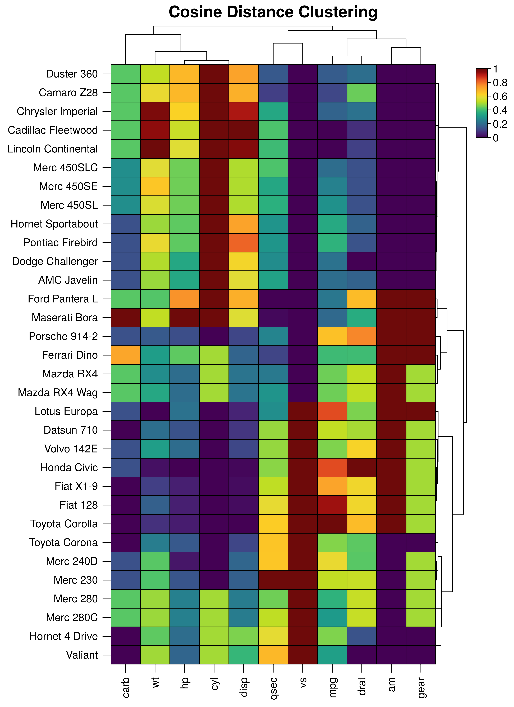
```

**Absolute Distance Thresholds**: When using cosine distance, `tree_cut` values between 0 and 1 are interpreted as absolute cosine distance thresholds rather than proportional tree heights. For example, `tree_cut_x = 0.5` means cluster at cosine distance of 0.5, not at 50% of the tree height. This provides more intuitive control over clustering based on actual distance values.

```{r, eval = FALSE}
# Cut at absolute cosine distance of 0.5
heat_map(
  mtcars,
  scale = "column",
  dist_method = "cosine",
  tree_x = TRUE,
  tree_cut_x = 0.5,
  tree_split_x = 1,
  title = "Cosine Distance with Absolute Threshold"
)
```

**Correlation distances and leaf order**: `dist_method` also accepts `"pearson"`, `"spearman"` and `"kendall"` for one minus the correlation, which groups rows that rise and fall together whatever their level (common for gene expression), or a function that takes the matrix being clustered and returns a `dist` object. A dendrogram can be drawn in many orders, as every branch can be flipped; `tree_order_x` and `tree_order_y` choose the order. `"olo"` (optimal leaf ordering) flips branches so that neighbouring rows are as similar as possible, giving smoother gradients, and `"mean"` orders branches by their mean values as `stats::heatmap()` does.

```{r, eval = FALSE}
set.seed(5)
mat <- matrix(
  rnorm(60 * 12),
  nrow = 60,
  dimnames = list(
    paste0("Gene_", 1:60),
    paste0("S", 1:12)
  )
)
# 20 genes that rise and fall together at different levels
profile <- rnorm(12)
mat[1:20, ] <- t(replicate(20, 3 * profile + rnorm(12, sd = 0.5))) +
  rnorm(20, sd = 4)
heat_map(
  mat,
  tree = "both",
  dist_method = "pearson",
  tree_order_x = "olo",
  tree_order_y = "olo",
  axis_text_y = NA,
  title = "Pearson distance, optimal leaf order"
)
```

```{r, eval = FALSE, echo = FALSE}
set.seed(5)
mat <- matrix(
  rnorm(60 * 12),
  nrow = 60,
  dimnames = list(
    paste0("Gene_", 1:60),
    paste0("S", 1:12)
  )
)
# 20 genes that rise and fall together at different levels
profile <- rnorm(12)
mat[1:20, ] <- t(replicate(20, 3 * profile + rnorm(12, sd = 0.5))) +
  rnorm(20, sd = 4)
heat_map_save(
  "vignettes/HeatmapR/HeatmapR-dist-order.png",
  height = 8,
  width = 7,
  res = 300
)
heat_map(
  mat,
  tree = "both",
  dist_method = "pearson",
  tree_order_x = "olo",
  tree_order_y = "olo",
  axis_text_y = NA,
  title = "Pearson distance, optimal leaf order"
)
```

```{r echo = FALSE, out.width = '95%', fig.align="center"}
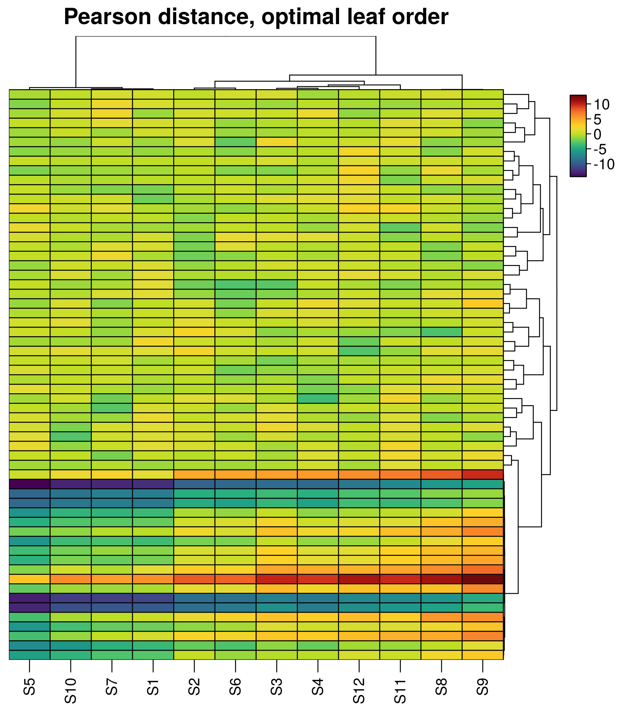
```

#### 5.1.2 Branch Support

A dendrogram always has branches, whether or not the data support them. `tree_support_y` (and `tree_support_x`) shows how stable each branch is: the columns are resampled with replacement, the rows are clustered again in the same way, and each branch scores the proportion of resamples in which its exact set of rows is a branch again (its bootstrap support). Branches with 90% support or more are drawn as thick black lines, 70-89% as grey lines and anything less as dashed lines, and the larger branches are labelled with their support. In `mtcars` only small groups, such as the Mazda RX4 pair, are stable; most of the larger splits come back less than half the time, which is worth knowing before cutting clusters from the dendrogram. `TRUE` uses 100 resamples, and the support is the same each time the heatmap is drawn.

```{r, eval = FALSE}
heat_map(
  mtcars,
  scale = "column",
  tree = "both",
  tree_size_y = 2,
  tree_support_x = 200,
  tree_support_y = 200,
  title = "Bootstrap support of each branch"
)
```

```{r, eval = FALSE, echo = FALSE}
heat_map_save(
  "vignettes/HeatmapR/HeatmapR-support.png",
  height = 8,
  width = 8,
  res = 300
)
heat_map(
  mtcars,
  scale = "column",
  tree = "both",
  tree_size_y = 2,
  tree_support_x = 200,
  tree_support_y = 200,
  title = "Bootstrap support of each branch"
)
```

```{r echo = FALSE, out.width = '95%', fig.align="center"}
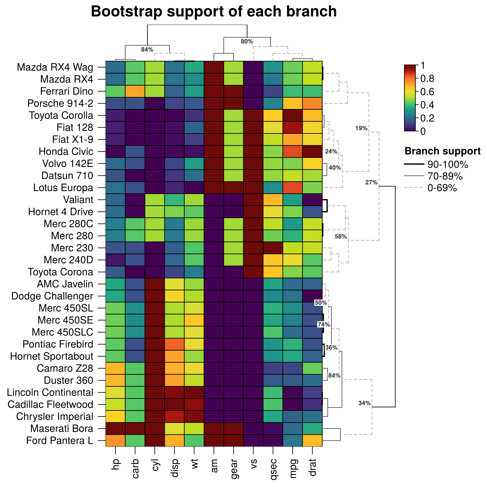
```

### 5.2 Clustering

The dendrograms on either axis can be optionally cut to reveal clusters in the data. Dendrogram cutting is performed via the `tree_cut_x` and `tree_cut_y` arguments which accept either a fixed number of clusters or a proportion of the total dendrogram height where the cut should be made. The clusters can be spatially separated by introducing splits in the heatmap using the `tree_split_x` and `tree_split_y` arguments which are scalars that control the height or width of the splits.

```{r, eval = FALSE}
heat_map(
  mtcars,
  scale = "column",
  dist_method = "euclidean",
  clust_method = "complete",
  tree_x = TRUE,
  tree_cut_x = 4,
  tree_split_x = 1,
  tree_y = TRUE,
  tree_size_y = 0.8,
  tree_cut_y = 5,
  tree_split_y = 1,
  title = "Hierarchical Clustering"
)
```

```{r, eval = FALSE, echo = FALSE}
heat_map_save(
  "vignettes/HeatmapR/HeatmapR-12.png",
  height = 11,
  width = 8,
  res = 500
)
heat_map(
  mtcars,
  scale = "column",
  dist_method = "euclidean",
  clust_method = "complete",
  tree_x = TRUE,
  tree_cut_x = 4,
  tree_split_x = 1,
  tree_y = TRUE,
  tree_size_y = 0.8,
  tree_cut_y = 5,
  tree_split_y = 1,
  title = "Hierarchical Clustering"
)
```

```{r echo = FALSE, out.width = '95%', fig.align="center"}
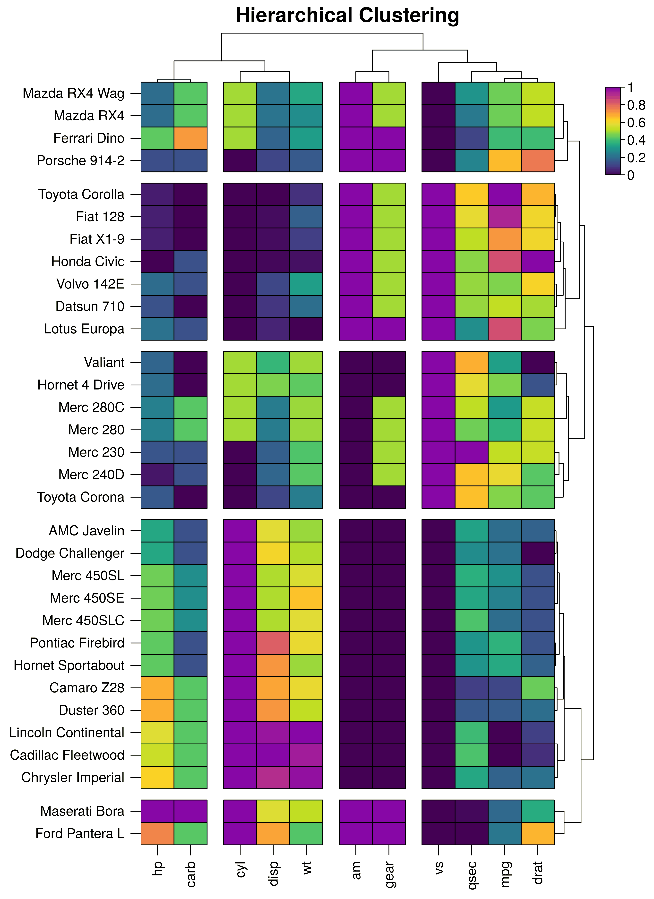
```

In addition to heatmap splitting, `heat_map()` also supports the labelling of clusters through the `tree_label_x`, `tree_label_text_x`, `tree_label_y` and `tree_label_text_y` arguments.

```{r, eval = FALSE}
heat_map(
  mtcars,
  scale = "column",
  tree_cut_x = 4,
  tree_split_x = 1,
  tree_label_x = TRUE,
  tree_label_text_x = c(1:4),
  tree_label_col_x = c(
    "red",
    "blue", 
    "green", 
    "magenta"
  ),
  tree_y = TRUE,
  tree_size_y = 0.8,
  tree_cut_y = 5,
  tree_split_y = 1,
  tree_label_y = TRUE,
  tree_label_text_y = c(1:5),
  tree_label_col_y = c(
    "red",
    "blue", 
    "green", 
    "magenta",
    "orange"
  ),
  title = "Cluster Labels"
)
```

```{r, eval = FALSE, echo = FALSE}
heat_map_save(
  "vignettes/HeatmapR/HeatmapR-13.png",
  height = 11,
  width = 8,
  res = 500
)
heat_map(
  mtcars,
  scale = "column",
  tree_cut_x = 4,
  tree_split_x = 1,
  tree_label_x = TRUE,
  tree_label_text_x = c(1:4),
  tree_label_col_x = c(
    "red",
    "blue", 
    "green", 
    "magenta"
  ),
  tree_y = TRUE,
  tree_size_y = 0.8,
  tree_cut_y = 5,
  tree_split_y = 1,
  tree_label_y = TRUE,
  tree_label_text_y = c(1:5),
  tree_label_col_y = c(
    "red",
    "blue", 
    "green", 
    "magenta",
    "orange"
  ),
  title = "Cluster Labels"
)
```

```{r echo = FALSE, out.width = '95%', fig.align="center"}
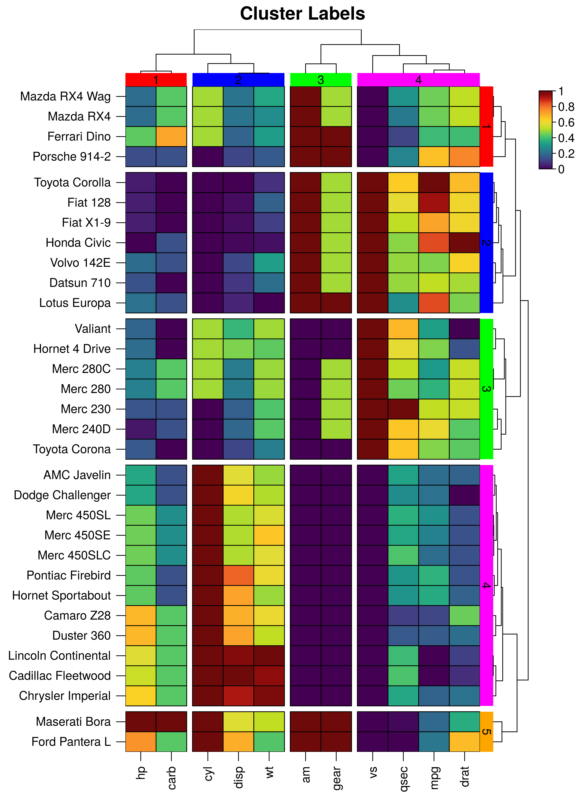
```

#### 5.2.1 Manual Clustering

In addition to automatic hierarchical clustering, **HeatmapR** allows you to manually define clusters in two ways: by specifying the number of elements in each cluster, or by providing a vector of cluster indices. This is particularly useful when you want to group data based on domain knowledge or external factors rather than hierarchical relationships.

**Method 1: Specify cluster sizes** - Provide a vector indicating the number of rows/columns in each cluster:

```{r, eval = FALSE}
# Manual clustering by specifying cluster sizes
# Create 3 clusters: 4 columns, 3 columns, 4 columns
heat_map(
  mtcars,
  scale = "column",
  tree_cut_x = c(4, 3, 4),
  tree_split_x = 1,
  tree_label_x = TRUE,
  tree_label_text_x = c("Group A", "Group B", "Group C"),
  title = "Manual Clustering by Size"
)
```

```{r, eval = FALSE, echo = FALSE}
heat_map_save(
  "vignettes/HeatmapR/HeatmapR-13b.png",
  height = 11,
  width = 8,
  res = 500
)
heat_map(
  mtcars,
  scale = "column",
  tree_cut_x = c(4, 3, 4),
  tree_split_x = 1,
  tree_label_x = TRUE,
  tree_label_text_x = c("Group A", "Group B", "Group C"),
  tree_label_col_x = "white",
  title = "Manual Clustering by Size"
)
```

```{r echo = FALSE, out.width = '95%', fig.align="center"}
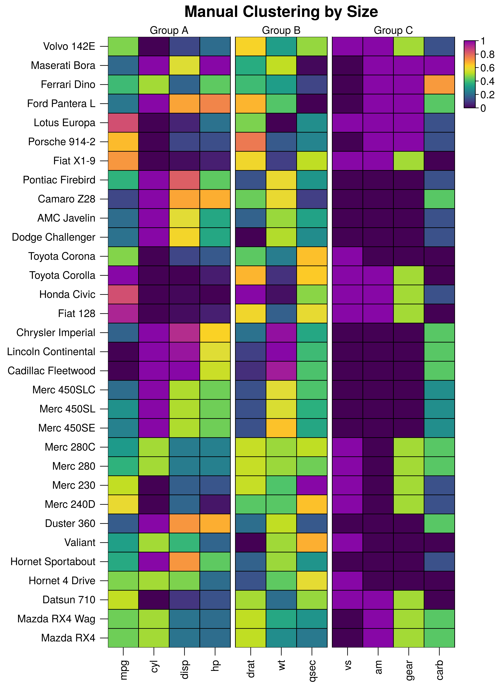
```

**Method 2: Specify cluster indices** - Provide a vector where each element indicates which cluster that row/column belongs to. Numeric indices are given as the heatmap is displayed - columns from the left, rows from the top, in the dendrogram order when a dendrogram is drawn and in the order of the data otherwise - so you can draw a heatmap, read it, and assign clusters to what you see. Labels given as characters or a factor (e.g. treatments from sample metadata) follow the original order of the data, and named vectors are matched by name. The rows/columns are regrouped so that each cluster is contiguous in the heatmap:

```{r, eval = FALSE}
# Manual clustering by assigning cluster indices
# Assign each of the 11 columns to specific clusters
cluster_indices <- c(1, 1, 1, 1, 2, 2, 2, 3, 3, 3, 3)

heat_map(
  mtcars,
  scale = "column",
  tree_cut_x = cluster_indices,
  tree_split_x = 1,
  tree_label_x = TRUE,
  tree_label_text_x = c("Low", "Medium", "High"),
  tree_label_col_x = c("blue", "yellow", "red"),
  title = "Manual Clustering by Index"
)
```

```{r, eval = FALSE, echo = FALSE}
heat_map_save(
  "vignettes/HeatmapR/HeatmapR-13c.png",
  height = 11,
  width = 8,
  res = 500
)
# Manual clustering by assigning cluster indices
cluster_indices <- c(1, 1, 1, 1, 2, 2, 2, 3, 3, 3, 3)

heat_map(
  mtcars,
  scale = "column",
  tree_cut_x = cluster_indices,
  tree_split_x = 1,
  tree_label_x = TRUE,
  tree_label_text_x = c("Low", "Medium", "High"),
  tree_label_col_x = c("blue", "yellow", "red"),
  title = "Manual Clustering by Index"
)
```

```{r echo = FALSE, out.width = '95%', fig.align="center"}
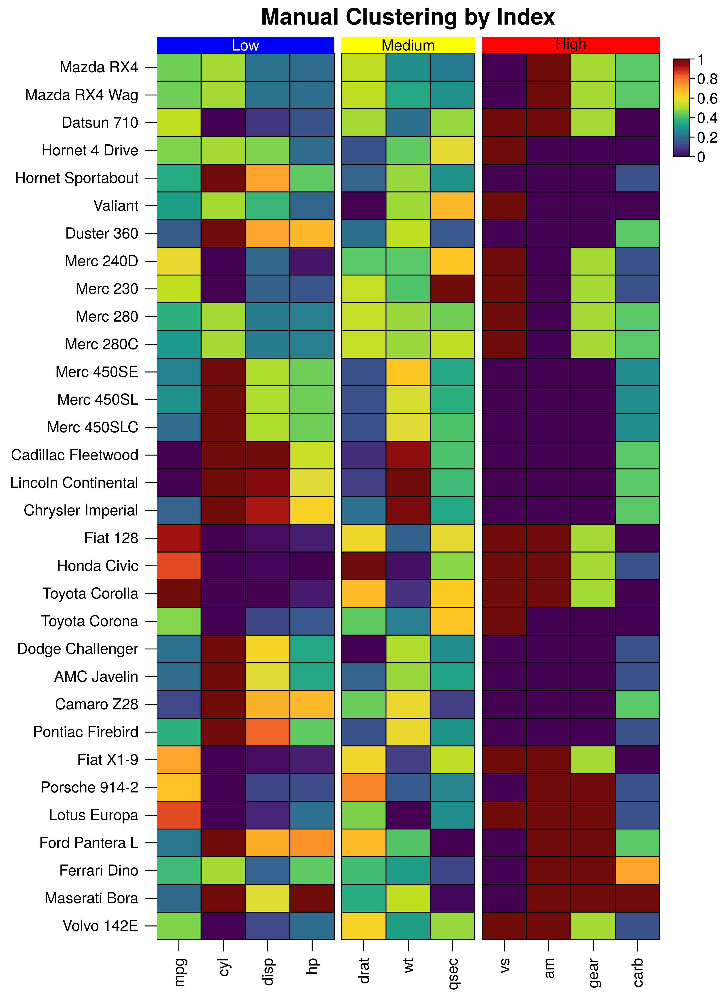
```

Manual clusters can be combined with dendrograms by setting `tree_x = TRUE` or `tree_y = TRUE`. The rows or columns are then clustered within each cluster, and the clusters are joined at the top of the dendrogram, so each group (e.g. a treatment, or a cell type) gets its own dendrogram:

```{r, eval = FALSE}
set.seed(4)
mat <- matrix(
  rnorm(40 * 24),
  nrow = 40,
  dimnames = list(
    paste0("Gene_", 1:40),
    paste0("S", sprintf("%02d", 1:24))
  )
)
treatment <- factor(
  rep(c("Control", "Drug_A", "Drug_B"), times = 8),
  levels = c("Control", "Drug_A", "Drug_B")
)
mat[1:10, treatment == "Drug_A"] <- mat[1:10, treatment == "Drug_A"] + 2
heat_map(
  mat,
  tree = "both",
  tree_cut_x = treatment,
  tree_label_x = TRUE,
  title = "Clustering within groups"
)
```

```{r, eval = FALSE, echo = FALSE}
set.seed(4)
mat <- matrix(
  rnorm(40 * 24),
  nrow = 40,
  dimnames = list(
    paste0("Gene_", 1:40),
    paste0("S", sprintf("%02d", 1:24))
  )
)
treatment <- factor(
  rep(c("Control", "Drug_A", "Drug_B"), times = 8),
  levels = c("Control", "Drug_A", "Drug_B")
)
mat[1:10, treatment == "Drug_A"] <- mat[1:10, treatment == "Drug_A"] + 2
heat_map_save(
  "vignettes/HeatmapR/HeatmapR-groups.png",
  height = 8,
  width = 8,
  res = 300
)
heat_map(
  mat,
  tree = "both",
  tree_cut_x = treatment,
  tree_label_x = TRUE,
  title = "Clustering within groups"
)
```

```{r echo = FALSE, out.width = '95%', fig.align="center"}
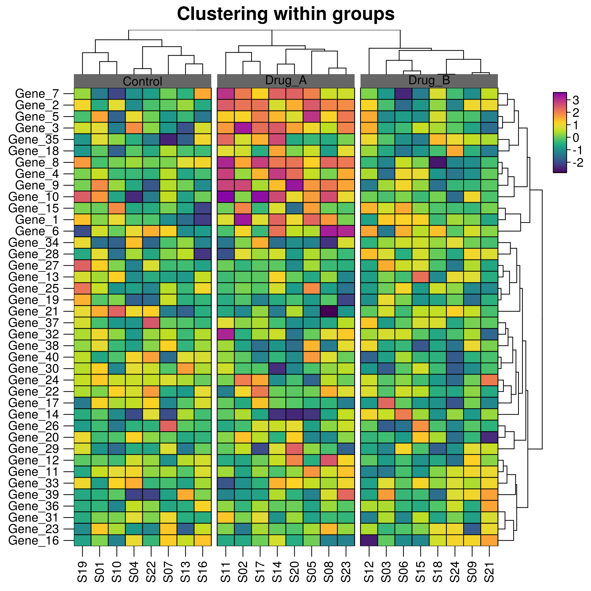
```

A dendrogram supplied as an `hclust` or `dist` object is kept only when the clusters are contiguous in its order, and is dropped with a warning otherwise.

The cluster assignments, row/column order and dendrograms used to construct a heatmap can be extracted from the returned object with `heat_map_info()`:

```{r, eval = FALSE}
hm <- heat_map(
  mtcars,
  scale = "column",
  tree_cut_x = 3,
  tree_cut_y = 4,
  popup = FALSE
)
info <- heat_map_info(hm)
info$row_clusters
rownames(mtcars)[info$row_order]
```

#### 5.2.2 k-means Clusters

For thousands of rows, `tree_kmeans_y` (or `tree_kmeans_x` for columns) splits the rows into k-means clusters instead of cutting a dendrogram. The rows are clustered on the scaled data, starting from slices of the rows along their first principal component, so the same clusters are found every time whatever the random seed, and similar clusters are placed next to each other. The k-means clusters then work like clusters supplied to `tree_cut_y`: they are separated by splits and can be labelled, and with `tree_y = TRUE` the rows are clustered within each k-means cluster. `heat_map_info()$row_clusters` returns the cluster of each row.

```{r, eval = FALSE}
set.seed(5)
genes <- matrix(
  rnorm(2000 * 12),
  nrow = 2000,
  dimnames = list(
    paste0("Gene_", 1:2000),
    paste0("S", 1:12)
  )
)
genes[1:400, 1:4] <- genes[1:400, 1:4] + 3
genes[401:800, 5:8] <- genes[401:800, 5:8] + 3
genes[801:1200, 9:12] <- genes[801:1200, 9:12] + 3
heat_map(
  genes,
  scale = "row",
  scale_method = "zscore",
  tree_kmeans_y = 4,
  tree_y = TRUE,
  axis_text_y = NA,
  title = "k-means clusters of 2,000 genes"
)
```

```{r, eval = FALSE, echo = FALSE}
set.seed(5)
genes <- matrix(
  rnorm(2000 * 12),
  nrow = 2000,
  dimnames = list(
    paste0("Gene_", 1:2000),
    paste0("S", 1:12)
  )
)
genes[1:400, 1:4] <- genes[1:400, 1:4] + 3
genes[401:800, 5:8] <- genes[401:800, 5:8] + 3
genes[801:1200, 9:12] <- genes[801:1200, 9:12] + 3
heat_map_save(
  "vignettes/HeatmapR/HeatmapR-kmeans.png",
  height = 8,
  width = 7,
  res = 300
)
heat_map(
  genes,
  scale = "row",
  scale_method = "zscore",
  tree_kmeans_y = 4,
  tree_y = TRUE,
  axis_text_y = NA,
  title = "k-means clusters of 2,000 genes"
)
```

```{r echo = FALSE, out.width = '95%', fig.align="center"}
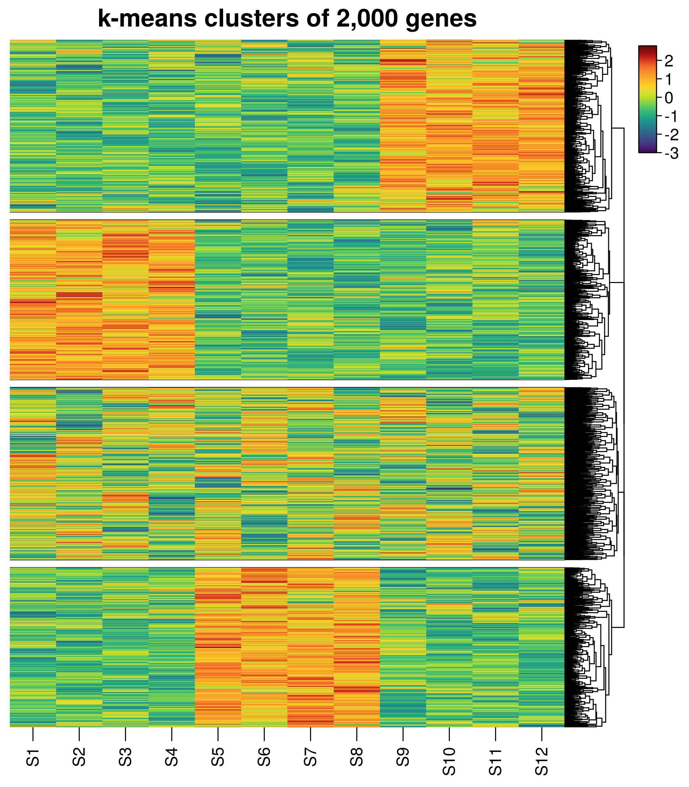
```

### 5.3 Group Summaries

`heat_map_summarise()` reduces the rows (`group_y`) or columns (`group_x`) of a dataset to one per group, such as the mean expression of each gene in each cell type, a pseudobulk view of single-cell data. `fun` chooses the summary: `"mean"`, `"median"`, `"sum"`, `"min"`, `"max"`, `"sd"`, `"n"`, `"detected"` (the proportion of values above `threshold`) or a function of your own. Summaries can be combined in a dot plot, with the mean expression as the colour and the proportion of cells in which each gene is detected as the size:

```{r, eval = FALSE}
set.seed(6)
types <- c("B cell", "T cell", "NK cell", "Monocyte")
markers <- c("CD19", "MS4A1", "CD3E", "CD4", "NKG7", "GNLY", "CD14", "LYZ")
cell_type <- sample(types, 2000, replace = TRUE)
# Expression of each marker in each cell type
rate <- matrix(runif(32, 0, 0.6), 4, dimnames = list(types, markers))
rate[cbind(rep(types, each = 2), markers)] <- runif(8, 2, 4)
expr <- matrix(
  rpois(2000 * 8, rate[cell_type, ]),
  ncol = 8,
  dimnames = list(NULL, markers)
)
expr <- log1p(expr)
heat_map(
  heat_map_summarise(expr, group_y = cell_type),
  cell_size = heat_map_summarise(expr, group_y = cell_type, fun = "detected"),
  cell_shape = "circle",
  cell_col_scale = "viridis",
  scale = "column",
  scale_method = "zscore",
  legend_title = c("Mean (z-score)", "Detected"),
  title = "Marker genes by cell type"
)
```

```{r, eval = FALSE, echo = FALSE}
set.seed(6)
types <- c("B cell", "T cell", "NK cell", "Monocyte")
markers <- c("CD19", "MS4A1", "CD3E", "CD4", "NKG7", "GNLY", "CD14", "LYZ")
cell_type <- sample(types, 2000, replace = TRUE)
# Expression of each marker in each cell type
rate <- matrix(runif(32, 0, 0.6), 4, dimnames = list(types, markers))
rate[cbind(rep(types, each = 2), markers)] <- runif(8, 2, 4)
expr <- matrix(
  rpois(2000 * 8, rate[cell_type, ]),
  ncol = 8,
  dimnames = list(NULL, markers)
)
expr <- log1p(expr)
heat_map_save(
  "vignettes/HeatmapR/HeatmapR-summarise.png",
  height = 3.55,
  width = 7,
  res = 300
)
heat_map(
  heat_map_summarise(expr, group_y = cell_type),
  cell_size = heat_map_summarise(expr, group_y = cell_type, fun = "detected"),
  cell_shape = "circle",
  cell_col_scale = "viridis",
  scale = "column",
  scale_method = "zscore",
  legend_title = c("Mean (z-score)", "Detected"),
  title = "Marker genes by cell type"
)
```

```{r echo = FALSE, out.width = '95%', fig.align="center"}
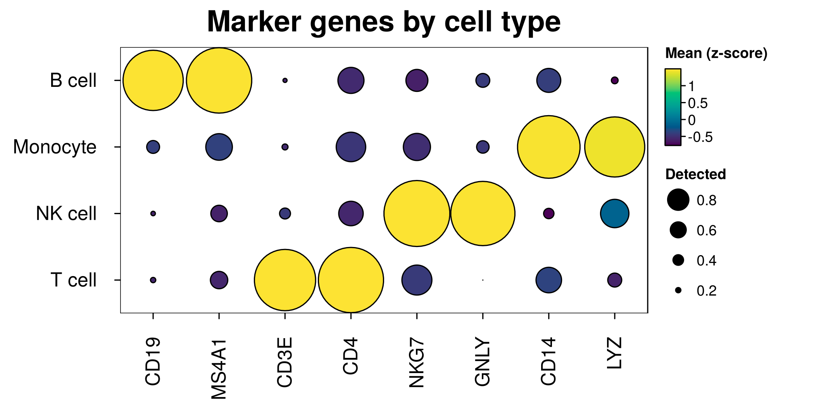
```

#### 5.3.1 Distributions Inside Cells

A summary hides the shape of the values behind it. `cell_values` takes a matrix holding the values behind each cell, such as `heat_map_summarise(fun = "values")`, and draws their distribution inside the cell: a density with a tick at the median by default, or a histogram or box plot with `cell_glyph`. Each column shares one range of values (`cell_glyph_range`), so the curves can be compared down the column. In the example below the "T mixed" cluster has middling CD4 and CD8 medians that look like a dim population; the densities show that it is two populations, one CD4+ and one CD8+.

```{r, eval = FALSE}
set.seed(8)
markers <- c("CD3", "CD4", "CD8", "CD19", "CD56", "CD14")
pops <- list(
  "CD4 T" = c("CD3", "CD4"),
  "CD8 T" = c("CD3", "CD8"),
  "T mixed" = "CD3",
  "B" = "CD19",
  "NK" = "CD56",
  "Monocyte" = "CD14"
)
cluster <- sample(names(pops), 6000, replace = TRUE)
events <- matrix(
  rnorm(6000 * 6, 0.5, 0.45),
  ncol = 6,
  dimnames = list(NULL, markers)
)
for (p in names(pops)) {
  ind <- cluster == p
  events[ind, pops[[p]]] <- rnorm(sum(ind) * length(pops[[p]]), 4, 0.55)
}
# Half of the "T mixed" cluster is CD4+, the other half CD8+
mixed <- which(cluster == "T mixed")
cd4 <- mixed[seq_along(mixed) %% 2 == 0]
events[cd4, "CD4"] <- rnorm(length(cd4), 4, 0.55)
cd8 <- setdiff(mixed, cd4)
events[cd8, "CD8"] <- rnorm(length(cd8), 4, 0.55)
heat_map(
  heat_map_summarise(events, group_y = cluster, fun = "median"),
  cell_values = heat_map_summarise(events, group_y = cluster, fun = "values"),
  legend_title = "Median",
  title = "Median intensity, with each cluster's distribution"
)
```

```{r, eval = FALSE, echo = FALSE}
set.seed(8)
markers <- c("CD3", "CD4", "CD8", "CD19", "CD56", "CD14")
pops <- list(
  "CD4 T" = c("CD3", "CD4"),
  "CD8 T" = c("CD3", "CD8"),
  "T mixed" = "CD3",
  "B" = "CD19",
  "NK" = "CD56",
  "Monocyte" = "CD14"
)
cluster <- sample(names(pops), 6000, replace = TRUE)
events <- matrix(
  rnorm(6000 * 6, 0.5, 0.45),
  ncol = 6,
  dimnames = list(NULL, markers)
)
for (p in names(pops)) {
  ind <- cluster == p
  events[ind, pops[[p]]] <- rnorm(sum(ind) * length(pops[[p]]), 4, 0.55)
}
# Half of the "T mixed" cluster is CD4+, the other half CD8+
mixed <- which(cluster == "T mixed")
cd4 <- mixed[seq_along(mixed) %% 2 == 0]
events[cd4, "CD4"] <- rnorm(length(cd4), 4, 0.55)
cd8 <- setdiff(mixed, cd4)
events[cd8, "CD8"] <- rnorm(length(cd8), 4, 0.55)
heat_map_save(
  "vignettes/HeatmapR/HeatmapR-cell-values.png",
  height = 5.6,
  width = 7,
  res = 300
)
heat_map(
  heat_map_summarise(events, group_y = cluster, fun = "median"),
  cell_values = heat_map_summarise(events, group_y = cluster, fun = "values"),
  legend_title = "Median",
  title = "Median intensity, with each cluster's distribution"
)
```

```{r echo = FALSE, out.width = '95%', fig.align="center"}
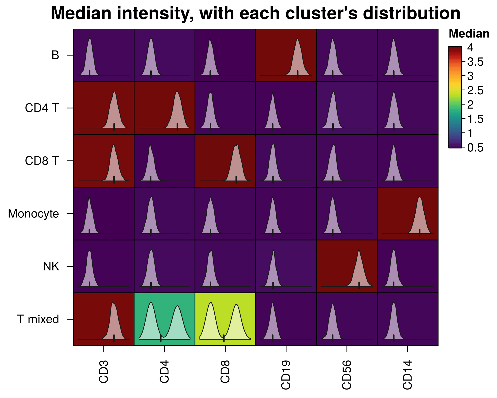
```

## 6. Legends

`heat_map()` will automatically add legends for the colour scale and size of the cells in the heatmap. The `legend` argument controls the type(s) of legends to display including `"colour"`, `"size"` or `"both"`, and `"levels"` can be added (e.g. `legend = c("both", "levels")`) to include a legend for the colours of non-numeric columns. The legend is sized from its contents: `legend_size` scales the legend keys (colour bars, swatches and size legend shapes) and `legend_col_scale_size` controls the width of the colour scale. The titles and text displayed in the legend(s) are also fully customisable using the the `legend_title_` and `legend_text_` family of arguments.

```{r, eval = FALSE}
heat_map(
  mtcars,
  scale = TRUE,
  tree_x = TRUE,
  tree_y = TRUE,
  cell_shape = "circle",
  cell_size = TRUE,
  legend = TRUE,
  legend_size = 1.5,
  legend_col_scale_size = 1.2,
  legend_title = c("colour", "size"),
  title = "Legends"
)
```

```{r, eval = FALSE, echo = FALSE}
heat_map_save(
  "vignettes/HeatmapR/HeatmapR-17.png",
  height = 11,
  width = 8,
  res = 500
)
heat_map(
  mtcars,
  scale = TRUE,
  tree_x = TRUE,
  tree_y = TRUE,
  cell_shape = "circle",
  cell_size = TRUE,
  legend = TRUE,
  legend_size = 1.5,
  legend_col_scale_size = 1.2,
  legend_title = c("colour", "size"),
  title = "Legends"
)
```

```{r echo = FALSE, out.width = '95%', fig.align="center"}
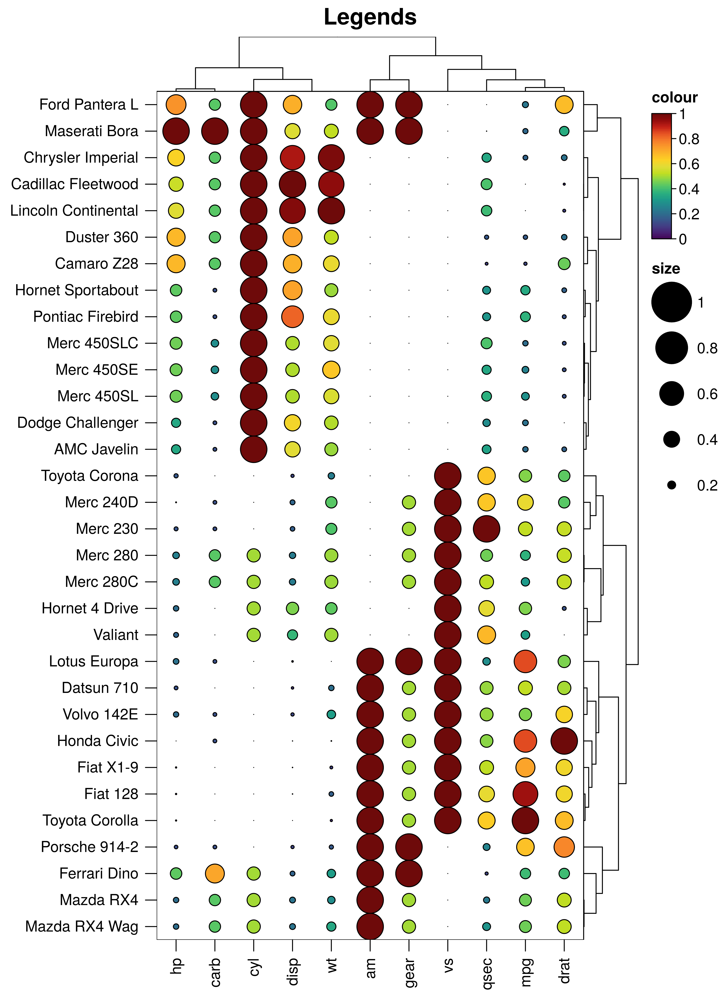
```

Legends can also be drawn below the heatmap with `legend_side = "bottom"`, where the colour bars are horizontal and the legends sit side by side, wrapping into rows when they don't fit across the figure. The colour scale itself can be shaped in a few ways: `cell_col_scale_limits = "robust"` uses the 2nd and 98th percentiles of the data so that a few outliers don't wash out the colours, `cell_col_scale_breaks` bins the values into a stepped colour scale, and `legend_col_breaks` chooses the values labelled on the colour legend (names become the labels).

```{r, eval = FALSE}
heat_map(
  scale(mtcars),
  tree = "both",
  tree_cut_x = 3,
  cell_col_scale = "Blue-Red 3",
  cell_col_scale_breaks = c(-3, -2, -1, 0, 1, 2, 3),
  legend_col_breaks = c(low = -3, 0, high = 3),
  legend_side = "bottom",
  legend_title = "z-score",
  title = "Legend below the heatmap"
)
```

```{r, eval = FALSE, echo = FALSE}
heat_map_save(
  "vignettes/HeatmapR/HeatmapR-legend-bottom.png",
  height = 8,
  width = 7,
  res = 300
)
heat_map(
  scale(mtcars),
  tree = "both",
  tree_cut_x = 3,
  cell_col_scale = "Blue-Red 3",
  cell_col_scale_breaks = c(-3, -2, -1, 0, 1, 2, 3),
  legend_col_breaks = c(low = -3, 0, high = 3),
  legend_side = "bottom",
  legend_title = "z-score",
  title = "Legend below the heatmap"
)
```

```{r echo = FALSE, out.width = '95%', fig.align="center"}
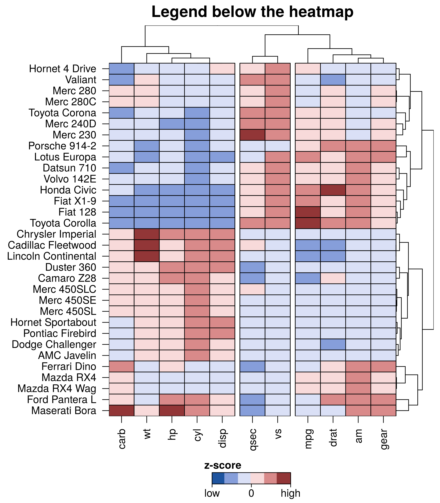
```

`legend_col_density = TRUE` traces the distribution of the values (a kernel density) over the colour legend, so you can see which colours most cells take and how much of the data sits near the ends of the scale. It is useful with robust limits, where the values beyond the limits all take the end colours.

```{r, eval = FALSE}
set.seed(5)
expr <- matrix(
  rnorm(40 * 12),
  nrow = 40,
  dimnames = list(paste0("Gene_", 1:40), paste0("S", 1:12))
)
expr[1:12, 1:6] <- expr[1:12, 1:6] + 1.5
# A few extreme values
expr[sample(length(expr), 9)] <- c(6.5, 7.2, 5.8, 8.1, 6, -5.5, -6.2, 6.8, 5.9)
heat_map(
  expr,
  tree = "both",
  axis_text_y = NA,
  cell_col_scale_limits = "robust",
  legend_col_density = TRUE,
  legend_title = "Expression",
  title = "Robust limits, with the data behind them"
)
```

```{r, eval = FALSE, echo = FALSE}
set.seed(5)
expr <- matrix(
  rnorm(40 * 12),
  nrow = 40,
  dimnames = list(paste0("Gene_", 1:40), paste0("S", 1:12))
)
expr[1:12, 1:6] <- expr[1:12, 1:6] + 1.5
# A few extreme values
expr[sample(length(expr), 9)] <- c(6.5, 7.2, 5.8, 8.1, 6, -5.5, -6.2, 6.8, 5.9)
heat_map_save(
  "vignettes/HeatmapR/HeatmapR-legend-density.png",
  height = 7,
  width = 7,
  res = 300
)
heat_map(
  expr,
  tree = "both",
  axis_text_y = NA,
  cell_col_scale_limits = "robust",
  legend_col_density = TRUE,
  legend_title = "Expression",
  title = "Robust limits, with the data behind them"
)
```

```{r echo = FALSE, out.width = '95%', fig.align="center"}
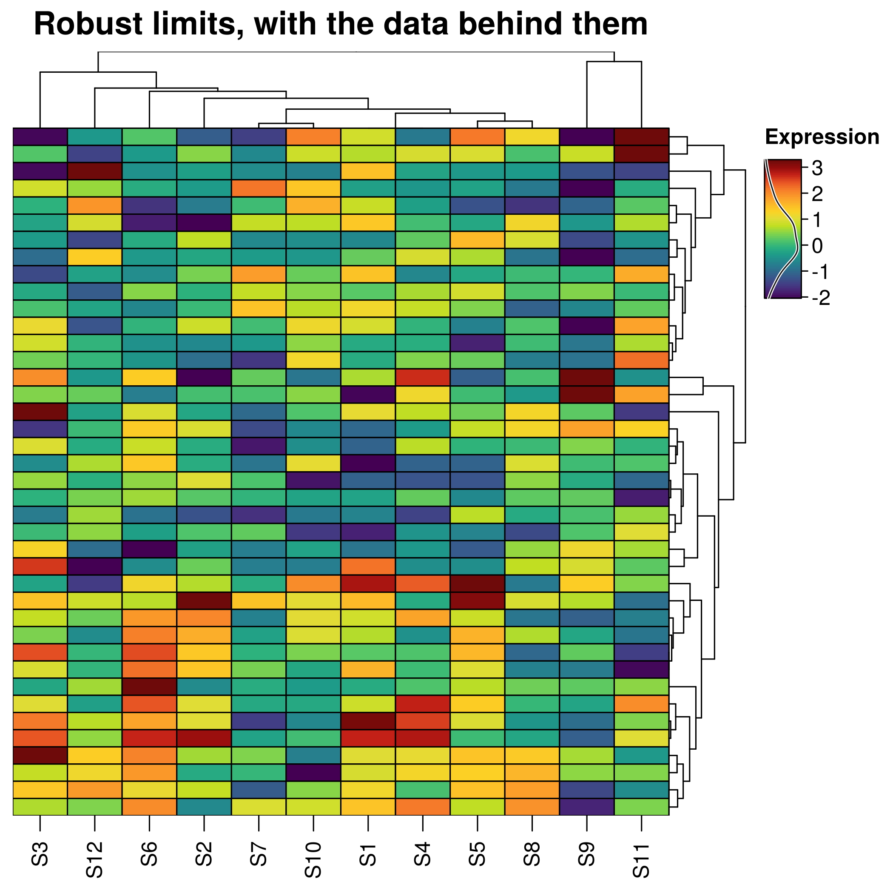
```

### 6.1 Layout

`heat_map()` sizes everything around the heatmap in inches from its contents: dendrograms and bar graphs keep the same size whatever the shape of the data (`tree_size_x`, `bar_size_x` etc. are multiples of 0.6 inches), the legend is as wide as its text, the margins are as wide as the axis text, axis labels and title, and the heatmap body takes the remaining space. Legends are stacked from the top of the heatmap and shrunk if they don't fit, and text is shrunk (or thinned) only when it would otherwise overlap. Below, the dendrograms, annotation track and legend are the same size for 60 genes as for 12.

```{r, eval = FALSE}
set.seed(3)
mat <- matrix(
  rnorm(60 * 8),
  nrow = 60,
  dimnames = list(
    paste0("Gene_", 1:60),
    paste0("Sample_", 1:8)
  )
)
mat[1:20, 1:4] <- mat[1:20, 1:4] + 2
group <- data.frame(
  Group = rep(c("Control", "Treated"), each = 4),
  row.names = colnames(mat)
)
heat_map_custom(
  popup = TRUE,
  popup_size = c(11, 6.5),
  layout = c(1, 2)
)
heat_map(
  mat,
  tree = "both",
  annotation_x = group,
  legend_title = "Expression",
  title = "60 genes"
)
heat_map(
  mat[1:12, ],
  tree = "both",
  annotation_x = group,
  legend_title = "Expression",
  title = "12 genes"
)
heat_map_complete()
```

```{r, eval = FALSE, echo = FALSE}
set.seed(3)
mat <- matrix(
  rnorm(60 * 8),
  nrow = 60,
  dimnames = list(
    paste0("Gene_", 1:60),
    paste0("Sample_", 1:8)
  )
)
mat[1:20, 1:4] <- mat[1:20, 1:4] + 2
group <- data.frame(
  Group = rep(c("Control", "Treated"), each = 4),
  row.names = colnames(mat)
)
heat_map_save(
  "vignettes/HeatmapR/HeatmapR-layout.png",
  height = 6.5,
  width = 11,
  res = 300,
  layout = c(1, 2)
)
heat_map(
  mat,
  tree = "both",
  annotation_x = group,
  legend_title = "Expression",
  title = "60 genes"
)
heat_map(
  mat[1:12, ],
  tree = "both",
  annotation_x = group,
  legend_title = "Expression",
  title = "12 genes"
)
heat_map_complete()
```

```{r echo = FALSE, out.width = '95%', fig.align="center", fig.alt = "Two clustered heatmaps side by side, of 60 and 12 genes, with dendrograms, annotation tracks and legends of the same size"}
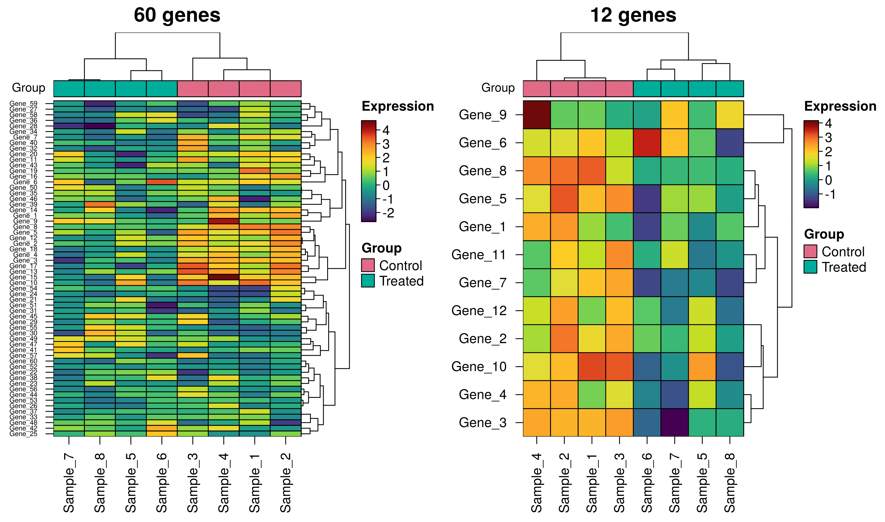
```

## 7. Complex Layouts

`HeatmapR` supports the arrangement of multiple heatmaps in complex layouts using `heat_map_custom()`. `heat_map_custom()` is called prior to plotting to open the appropriate graphics device and set the desired layout before adding the heatmaps. Once the layout is complete, a call is made to `heat_map_complete()` to reset all `heat_map()` associated settings. The `layout` argument can be either a vector indicating the desired number of rows and columns or a mtrix defining a more complex layout. For example, if we want to split different car brands into separate heatmaps and arrange them:

```{r, eval = FALSE}
heat_map_custom(
  popup = TRUE,
  popup_size = c(10, 15),
  layout = matrix(
    c(1,1,2,2,1,1,3,3),
    ncol = 4,
    nrow = 2,
    byrow = TRUE
  )
)
heat_map(
  mtcars[grepl("Merc", rownames(mtcars)),],
  title = "Mercedes"
)
heat_map(
  mtcars[grepl("Mazda|Toyota", rownames(mtcars)),],
  title = "Mazda | Toyota"
)
heat_map(
  mtcars[grepl("Hornet|Datsun|Volvo", rownames(mtcars)),],
  title = "Hornet | Datsun | Volvo"
)
heat_map_complete()
```

```{r, eval = FALSE, echo = FALSE}
heat_map_save(
  "vignettes/HeatmapR/HeatmapR-14.png",
  height = 5,
  width = 12,
  res = 500,
  layout = matrix(
    c(1,1,2,2,1,1,3,3),
    ncol = 4,
    nrow = 2,
    byrow = TRUE
  )
)
heat_map(
  mtcars[grepl("Merc", rownames(mtcars)),],
  title = "Mercedes"
)
heat_map(
  mtcars[grepl("Mazda|Toyota", rownames(mtcars)),],
  title = "Mazda | Toyota"
)
heat_map(
  mtcars[grepl("Hornet|Datsun|Volvo", rownames(mtcars)),],
  title = "Hornet | Datsun | Volvo"
)
heat_map_complete()
```

```{r echo = FALSE, out.width = '95%', fig.align="center"}
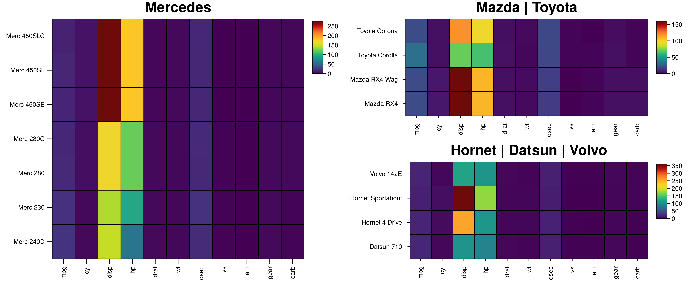
```

`HeatmapR` also supports layouts with other plots generated using base graphics. For example, we could arrange a heatmap with a scatterplot and a boxplot. 

```{r, eval = FALSE}
heat_map_custom(
  popup = TRUE,
  popup_size = c(10, 15),
  layout = matrix(
    c(1,1,2,2,1,1,3,3),
    ncol = 4,
    nrow = 2,
    byrow = TRUE
  )
)
heat_map(
  mtcars,
  title = "mtcars"
)
plot(
  mtcars[, c("disp", "hp")],
  xlab = "Displacement",
  ylab = "Horsepower",
  main = "mtcars: Displacement vs Horsepower",
  pch = 16,
  col = "black"
)
boxplot(
  mtcars[, "disp"],
  main = "Displacement",
  xlab = "Displacement (cu.in.)",
  horizontal = TRUE
)
heat_map_complete()
```

```{r, eval = FALSE, echo = FALSE}
heat_map_save(
  "vignettes/HeatmapR/HeatmapR-15.png",
  height = 8,
  width = 10,
  res = 500,
  layout = matrix(
    c(1,1,2,2,1,1,3, 3),
    ncol = 4,
    nrow = 2,
    byrow = TRUE
  )
)
heat_map(
  mtcars,
  scale = "column",
  cell_size = TRUE,
  legend_size = 1.5,
  title = "mtcars"
)
plot(
  mtcars[, c("disp", "hp")],
  xlab = "Displacement",
  ylab = "Horsepower",
  main = "mtcars: Displacement vs Horsepower",
  pch = 16,
  col = "black"
)
abline(
  lm(hp ~ disp, data = mtcars),
  col = "red",
  lty = 2
)
boxplot(
  mtcars[, "disp"],
  main = "Displacement",
  xlab = "Displacement (cu.in.)",
  horizontal = TRUE
)
heat_map_complete()
```

```{r echo = FALSE, out.width = '95%', fig.align="center"}
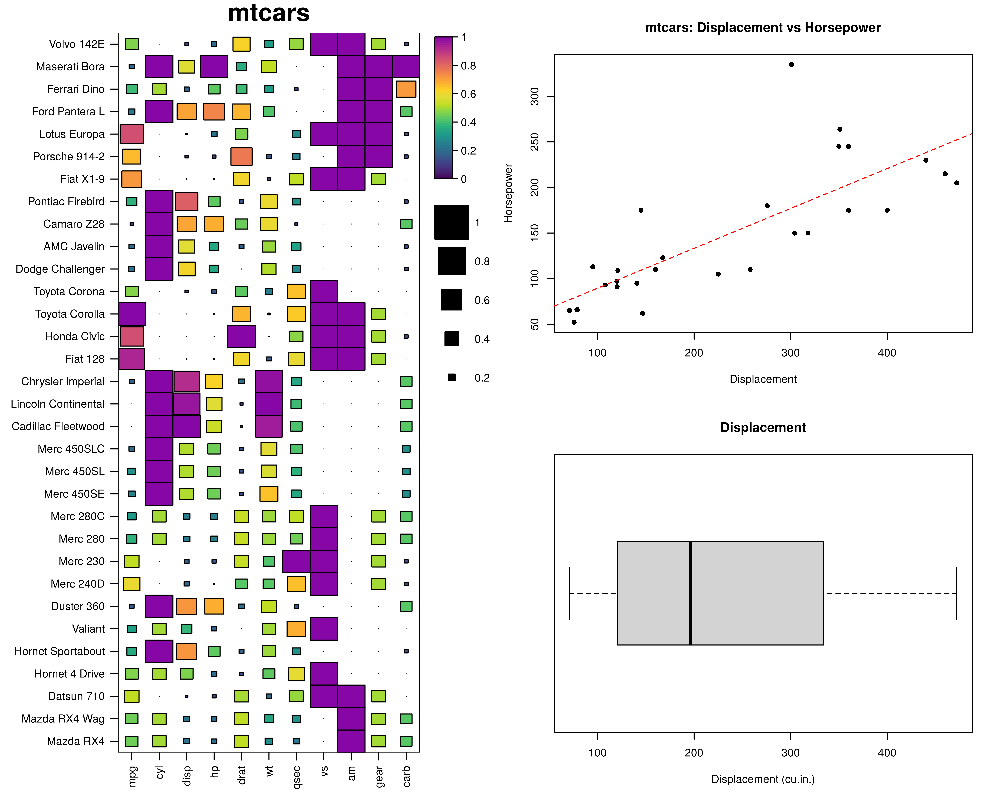
```

### 7.1 Heatmaps Beside ggplot2 Plots

`heat_map_grob()` turns a heatmap into a `grid` graphical object (a grob), so it can sit beside `ggplot2` plots in `patchwork`, `cowplot` or `gridExtra` layouts. The grob draws the heatmap again whenever its space changes, so the dendrograms, legends and text are sized for the space the heatmap is given. Arguments passed to `heat_map_grob()` replace those the heatmap was drawn with, e.g. `heat_map_grob(hm, title = NULL)`. It needs the `gridGraphics` package.

```{r, eval = FALSE}
library(ggplot2)
library(patchwork)
hm <- heat_map(
  mtcars,
  scale = "column",
  tree = "both",
  tree_cut_y = 3,
  title = "mtcars"
)
p <- ggplot(mtcars, aes(wt, mpg, colour = factor(cyl))) +
  geom_point(size = 2) +
  labs(x = "Weight (1000 lbs)", y = "Miles per gallon", colour = "Cylinders") +
  theme_bw()
p + heat_map_grob(hm) + plot_layout(widths = c(1, 1.5))
```

```{r echo = FALSE, out.width = '95%', fig.align="center", fig.alt = "A scatter plot of miles per gallon against weight for the mtcars data, coloured by the number of cylinders, beside a clustered heatmap of the same cars"}
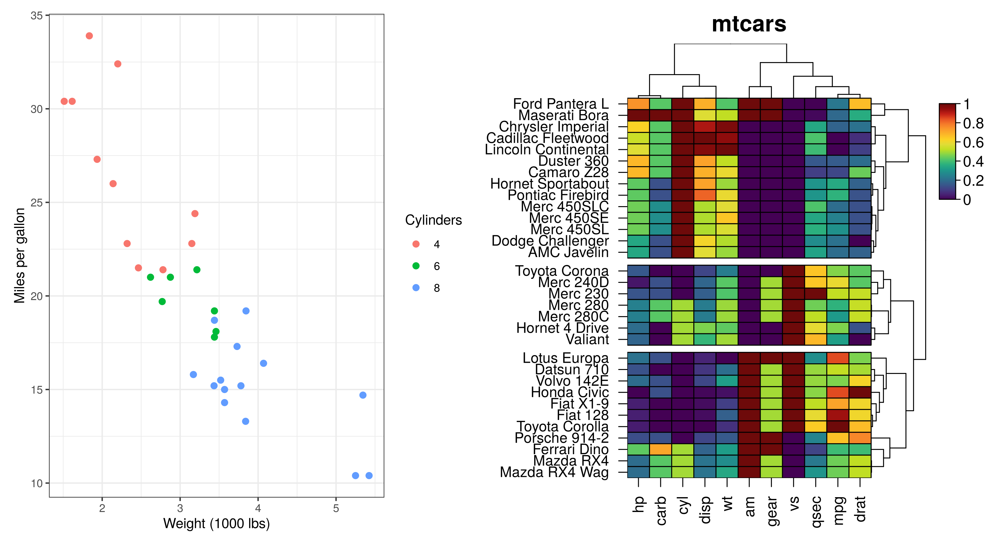
```

### 7.2 Heatmap Data for ggplot2 and Other Tools

`heat_map_data()` returns what a heatmap shows as tidy tables: one row per cell (the default), row, column or dendrogram segment. Rows and columns are listed in the order they are displayed, and `x` and `y` are the centres of the cells in the heatmap's plot co-ordinates, including the gaps between clusters, so the cells can be rebuilt or restyled with `ggplot2`, exported, or used to draw on the heatmap with base graphics.

```{r, eval = FALSE}
cells <- heat_map_data(hm)
rows <- heat_map_data(hm, "rows")
cols <- heat_map_data(hm, "columns")
tree <- heat_map_data(hm, "tree_y")
# Dendrogram to the right of the cells, its heights scaled to 3 cells
edge <- max(cells$x) + 0.5
grow <- function(h) edge + 3 * h / max(tree$x)
ggplot(cells) +
  geom_tile(aes(x, y, fill = value), colour = "white") +
  geom_segment(
    data = tree,
    aes(x = grow(x), y = y, xend = grow(xend), yend = yend)
  ) +
  scale_fill_distiller(palette = "RdBu", name = "Scaled\nvalue") +
  scale_x_continuous(breaks = cols$x, labels = cols$column) +
  scale_y_continuous(breaks = rows$y, labels = rows$row) +
  labs(x = NULL, y = NULL) +
  theme_minimal() +
  theme(
    panel.grid = element_blank(),
    axis.text.x = element_text(angle = 90, hjust = 1, vjust = 0.5)
  )
```

```{r echo = FALSE, out.width = '75%', fig.align="center", fig.alt = "The mtcars heatmap rebuilt with ggplot2 from heat_map_data(), with a red-blue fill scale, the same row clusters and gaps, and the row dendrogram on the right"}
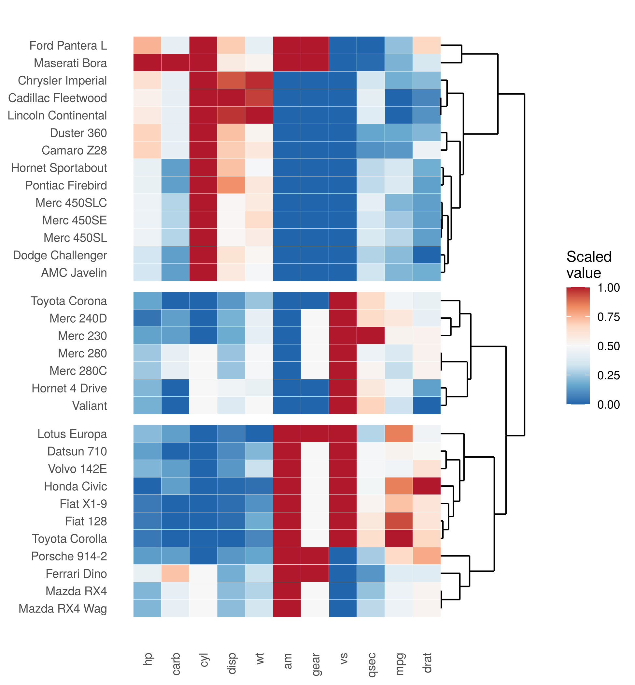
```

Drawn straight after `heat_map()`, base graphics land on the cells: `points(cells$x, cells$y)` marks the centre of every cell.

## 8. Export

`HeatmapR` supports the export of high resolution images using `heat_map_save()` which allows control over the dimensions and resolution of the exported image. 

```{r, eval = FALSE}
heat_map_save(
  "mtcars.png",
  height = 9.5,
  width = 5.7,
  res = 500
)
heat_map(
  mtcars,
  scale = "column",
  scale_method = "range",
  tree_x = TRUE,
  tree_y = TRUE,
  tree_cut_x = 4,
  tree_cut_y = 12,
  cell_size = TRUE,
  cell_shape = "circle",
  title = "mtcars"
)
heat_map_complete()
```

```{r, eval = FALSE, echo = FALSE}
heat_map_save(
  "vignettes/HeatmapR/HeatmapR-16.png",
  height = 9.5,
  width = 5.7,
  res = 500
)
heat_map(
  mtcars,
  scale = "column",
  scale_method = "range",
  tree_x = TRUE,
  tree_y = TRUE,
  tree_cut_x = 4,
  tree_cut_y = 12,
  cell_size = TRUE,
  cell_shape = "circle",
  title = "mtcars"
)
heat_map_complete()
```

```{r echo = FALSE, out.width = '95%', fig.align="center"}
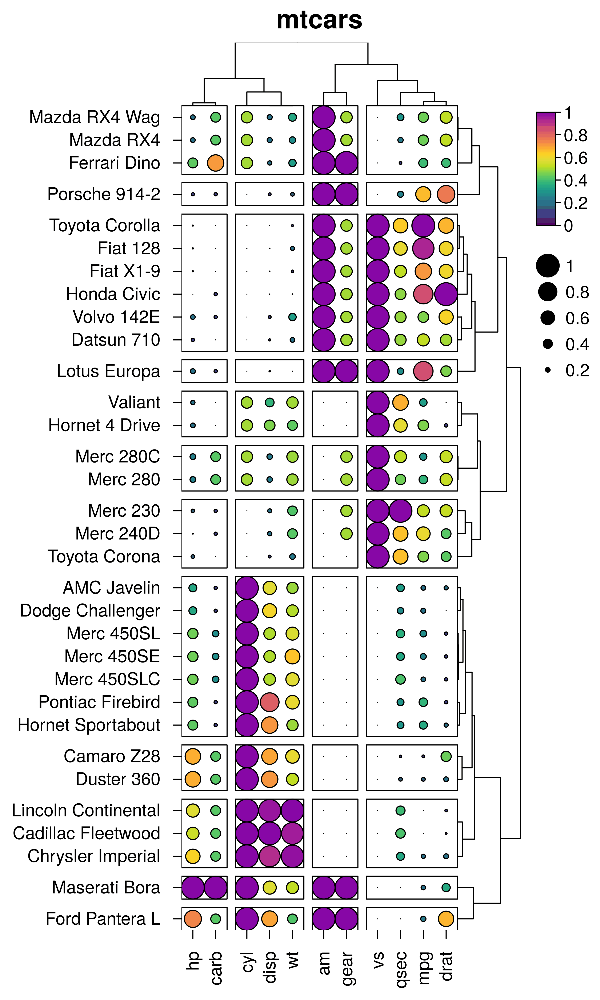
```

## 9. Describing a Heatmap

Readers who use screen readers can't see a heatmap, so figures need alternative text that says what they show. `heat_map_describe()` writes this description in plain language from the heatmap itself: its size and scaling, what the colours show, the most extreme values, how the rows and columns are clustered and what sets each cluster apart, and any annotations, bars, labels or panels. Pass it to the `fig.alt` chunk option in R Markdown or Quarto, or use it as a starting point for a figure legend.

```{r, eval = FALSE}
hm <- heat_map(
  mtcars,
  scale = "zscore",
  tree = "both",
  tree_cut_y = 3,
  legend_title = "z-score",
  title = "mtcars"
)
heat_map_describe(hm)
```

```
Heatmap titled "mtcars" of 32 rows by 11 columns, converted to z-scores within
each column. Colours show z-score, from dark purple (-1.87) through yellow
green to dark red (3.21). The highest value is 3.21 (Maserati Bora, carb) and
the lowest is -1.87 (Ford Pantera L, qsec). Rows are ordered by hierarchical
clustering (euclidean distance, complete linkage). Rows are split into 3
groups, numbered from the top: group 1 (15 rows, e.g. Hornet 4 Drive and
Valiant) is highest in vs and mpg and lowest in cyl and hp; group 2 (12 rows,
e.g. Chrysler Imperial and Cadillac Fleetwood) is highest in disp and cyl and
lowest in gear and drat; group 3 (5 rows, e.g. Ferrari Dino and Mazda RX4) is
highest in carb and gear and lowest in qsec and vs. Columns are ordered by
hierarchical clustering (euclidean distance, complete linkage).
```

In a chunk that draws the heatmap, compute the description in an earlier chunk and refer to it, e.g. `fig.alt = as.character(heat_map_describe(hm))`. Clusters are described by the columns in which their mean is highest and lowest (rows, for clusters of columns), and `max_groups` limits how many clusters are described one by one.

## 10. Summary

`HeatmapR` is a lightweight R package built on base graphics that allows for the creation of high resolution complex heatmaps that can be arranged in sophisticated layouts with other plot objects. 
