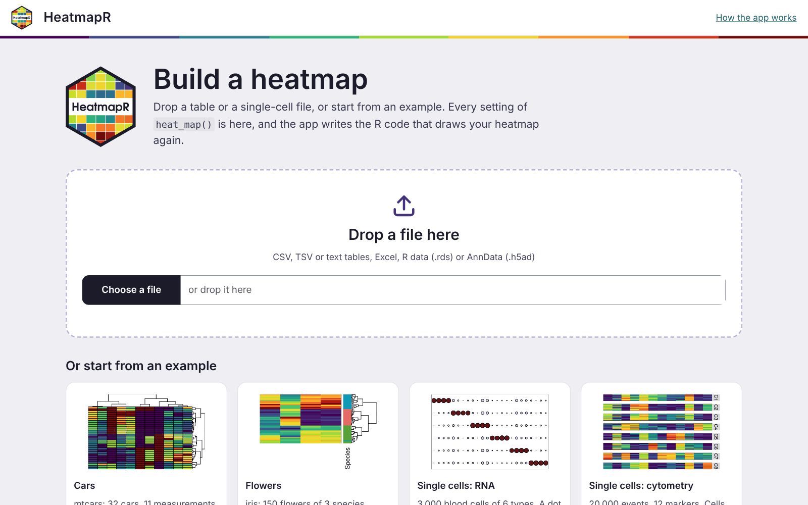
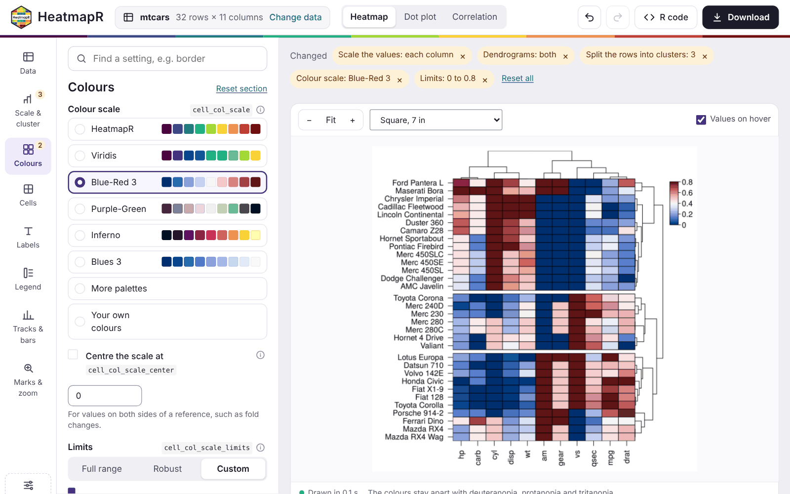
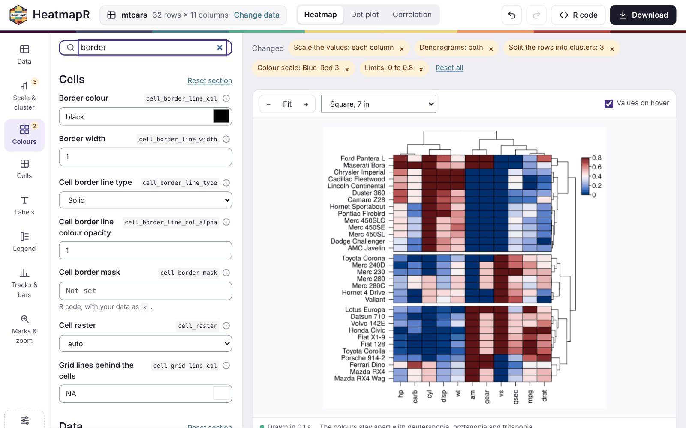
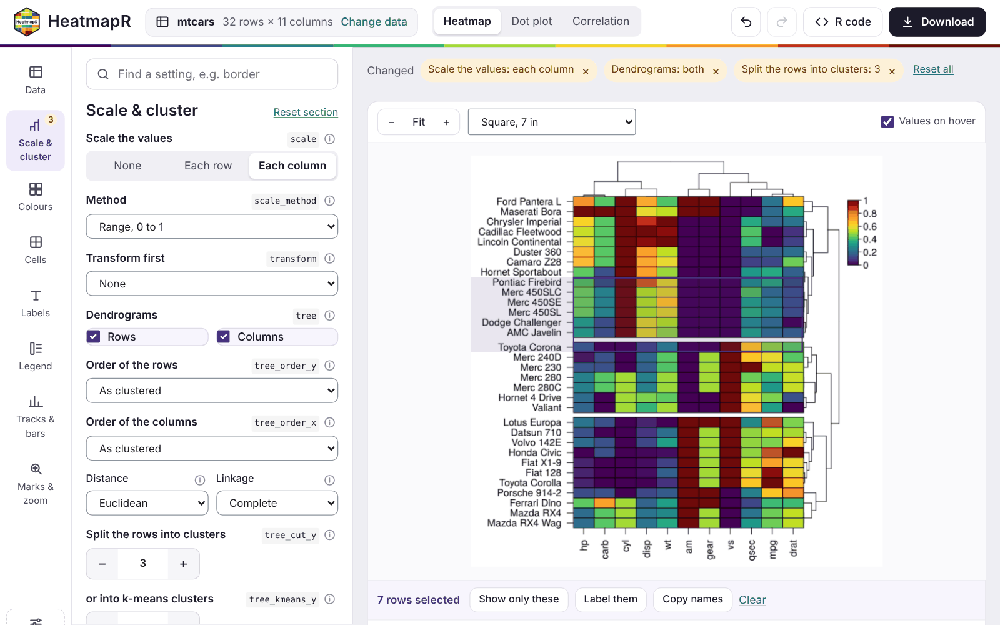
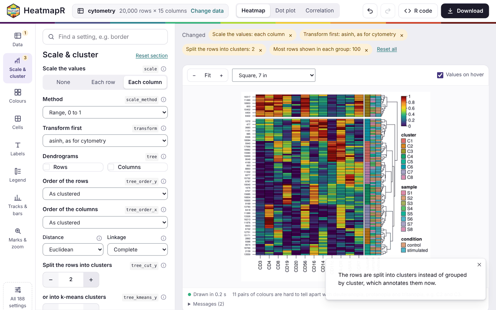
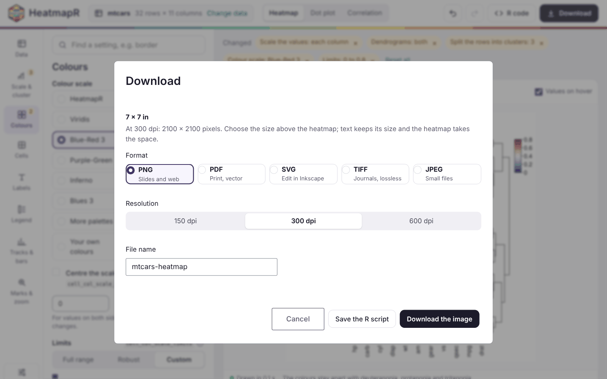
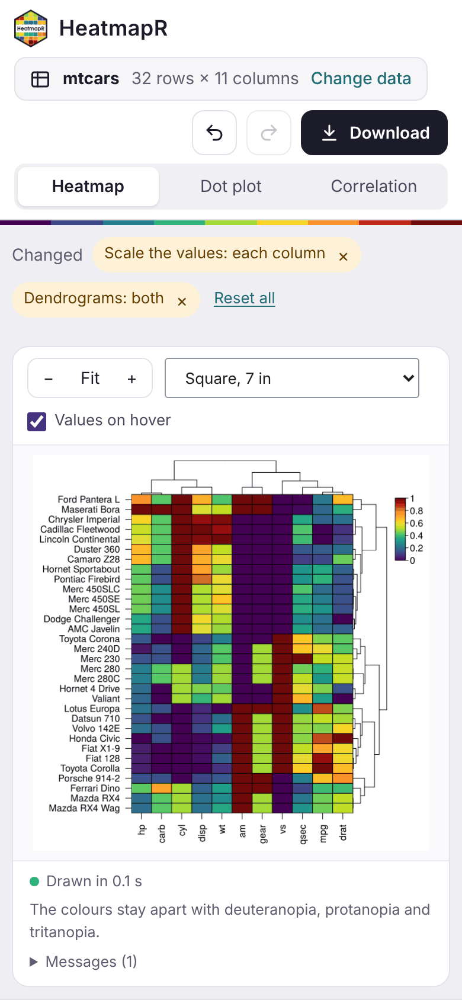

```{r, include = FALSE}
knitr::opts_chunk$set(
  collapse = TRUE,
  comment = "#>",
  message = FALSE,
  fig.width = 7,
  fig.height = 7,
  out.width = "100%",
  fig.align = "center"
)
```

`heat_map_app()` opens an app in the browser to build a heatmap without writing any code. You can drop a table or a single-cell file on it, choose a heatmap, a dot plot or a correlation heatmap, and set any argument of `heat_map()`. The heatmap redraws as you go. Beside it, the app writes the R code that draws the same figure again, so whatever you make in the app can be reproduced, shared and edited in a script.

The app is a [Shiny](https://shiny.posit.co/) app: it needs the shiny and bslib packages, and readxl to read Excel files.

```{r install, eval = FALSE}
install.packages(c("shiny", "bslib", "readxl"))
```

## Starting the app

With no data, the app opens on its start page. You can drop a file on it or choose one of four examples: `mtcars`, `iris`, and the single-cell RNA and cytometry data of `heat_map_example()`. The app can also start straight from data in R, or from a file, with any settings of `heat_map()`:

```{r start, eval = FALSE}
library(HeatmapR)
heat_map_app()                 # the start page
heat_map_app(mtcars, scale = "column", tree = "both")
heat_map_app("counts.csv")     # a file
heat_map_app(sce)              # a SingleCellExperiment or Seurat object
```

It reads these files:

- tables: CSV, TSV and text files (the separator is worked out), and Excel files;
- R data files (`.rds`), which can hold any data that `heat_map()` draws, including single-cell objects;
- AnnData files (`.h5ad`).

`heat_map_app()` returns the app, which runs when it's printed at the console. In a script, pass it to `shiny::runApp()`.



## The workspace


- **The top bar** shows the data, with *Change data*, and the kind of plot: *Heatmap*, *Dot plot* or *Correlation*. It also has undo and redo, *R code* (a panel with the code) and *Download*.
- **The rail** on the left holds the sections of the settings: Data, Scale & cluster, Colours, Cells, Labels, Legend, Tracks & bars, and Marks & zoom. A badge shows how many settings of a section you've changed. *All 188 settings* lists every argument.
- **The panel** shows the settings of the section chosen.
- **Above the heatmap**, the settings you've changed are listed as chips. Each chip has a button that resets it, and *Reset all* resets everything.
- **Below the heatmap**, a status line gives the time taken to draw it and the result of `heat_map_check_colours()`. Any messages from `heat_map()` are kept under *Messages*.

The heatmap is drawn again a moment after each change. When a change only affects the look of the heatmap, the clustering is reused, so styling a large heatmap stays quick.

## Data

The *Data* section says how each column of a table is used. In a table of up to 40 columns, each column gets one of these roles:

- shown in the heatmap;
- grouping the rows (`group_by`);
- annotating them (`annotation_by`);
- left out.

The app chooses roles to start with: numeric columns are shown, and text columns of up to 30 values annotate the rows. A first column of unique text, such as gene or sample names, becomes the row names. Wider tables, and single-cell data, are set with pickers instead:

- the features to show;
- the columns of metadata to group and annotate the cells by;
- the assay to use.

Single-cell data start grouped by their cell type or cluster column when they have one. *Another file* and *Example* in the same section change the data. Settings that only make sense for the old data, such as marked rows or a number of clusters, are reset, and a notice says so.


## Heatmaps, dot plots and correlations

The switch in the top bar changes the kind of plot:

- **Heatmap** draws `heat_map()` of the data.
- **Dot plot** draws `heat_map_dot()`: one dot for each group and feature, with the mean as its colour and the share of cells detected as its size. It needs groups, chosen in *Data*.
- **Correlation** draws `heat_map_cor()`, the correlations between the columns shown, for tables.

Dot plots and correlations get their own section of settings, such as the threshold of detection, splitting the dots by two conditions, or the method and layout of the correlations. These plots are drawn by `heat_map()` from a summary of the groups or from the correlation matrix. So the settings of heatmaps that would rescale, subsample or annotate that summary are hidden while they're shown. The settings of each kind of plot are kept while you look at another.


## Settings

Each setting has a plain label, the name of its argument beside it, and its documentation one click away behind the info button. The settings used most come first in their section, with inputs made for them:

- buttons for choices;
- steppers for numbers of clusters;
- palettes shown as strips of their colours;
- the limits of the colour scale over a histogram of the values, so you can see which values fall outside them.

The rest are under *More settings* in each section. The search box at the top finds any setting by its label or its argument, e.g. `border`.





Undo and redo step back and forward through your changes, including changes of plot. When a combination of settings can't be drawn, the reason is shown, along with buttons that reset the settings involved, and the last heatmap that worked stays on screen.

Some settings take values that belong to the data, such as `bar_values_y` for the values of a bar beside each row. These are R code, run with the data as `x`, so `bar_values_y = x$mpg` draws a bar for the `mpg` of each car.

## Exploring the heatmap

- **Hover** over the heatmap to see the values of a cell: its value before and after scaling, and its cluster and annotations.
- **Select** rows and columns by clicking or dragging over the cells. Then:
  - *Show only these* keeps them. That means the rows of a table, the groups of a dot plot, or the features selected.
  - *Label these* marks them on the heatmap (`mark_y`, `mark_x`).
  - The copy button copies their names.
- **Zoom** in and out with the buttons above the heatmap, and fit it to the window again with *Fit*.
- **Size** the heatmap with the menu beside them, which sets the size of the figure:
  - a square of 7 inches;
  - a journal column (3.5 inches) or page (7.2 by 6 inches);
  - a 16:9 slide;
  - A4;
  - your own size.

  Text keeps its size, and the cells take the space left.



## Clusters and groups

`heat_map()` groups the rows either by a column (`group_by`) or by the clusters of a dendrogram or k-means (`tree_cut_y`, `tree_kmeans_y`), not both. The app goes with your latest choice:

- **Splitting grouped rows into clusters** stops grouping them. The column that grouped them annotates them instead.
- **Grouping the rows again** drops the clusters.

A note says what changed each time.



## The R code

The *R code* panel holds the code that draws the heatmap again, with only the settings you changed. The line of your last change is highlighted, and *Copy* and *Save .R* take the code away. For the heatmap of mtcars above, the app writes:

```{r code, eval = FALSE}
library(HeatmapR)

x <- mtcars
hm <- heat_map(
  x,
  scale = "column",
  tree = "both",
  tree_cut_y = 3
)
heat_map_save("mtcars-heatmap.png", x = hm,
              width = 7, height = 7, res = 300)
```

which draws, here without saving it:

```{r code-run, fig.alt = "The heatmap of mtcars from the app's code: scaled within each column, both dendrograms, and the cars split into three clusters."}
library(HeatmapR)
x <- mtcars
heat_map(x, scale = "column", tree = "both", tree_cut_y = 3)
```

The code reads the data as the app did. A file is read with the same function and options (e.g. `read.csv("counts.csv", row.names = 1, check.names = FALSE)`), and an example with `heat_map_example()`. Rows kept with *Show only these* are kept by name. For the dot plot above:

```{r code-dot, eval = FALSE}
library(HeatmapR)

x <- heat_map_example("rna")
hm <- heat_map_dot(
  x,
  features = c("CD3E", "IL7R", "CCR7", "LDHB", "CD8A", "CD8B", "GZMK", "CCL5",
               "MS4A1", "CD79A", "CD79B", "BANK1", "GNLY", "NKG7", "PRF1",
               "GZMB", "CD14", "LYZ", "S100A8", "S100A9", "FCER1A", "CST3",
               "CLEC10A", "CD1C"),
  group_by = "cell_type",
  split_by = "condition"
)
heat_map_save("rna-dot-plot.png", x = hm,
              width = 7, height = 7, res = 300)
```

## Downloading

*Download* saves the heatmap at the size chosen above it, as:

- PNG, for slides and the web;
- PDF, for print, as vectors;
- SVG, to edit in a program such as Inkscape;
- TIFF, for journals, without losing detail;
- JPEG, for small files.

The resolution can be 150, 300 or 600 dpi. *Save the R script* downloads the code beside the image.



## Phones and tablets

On a narrow screen, the sections of the settings scroll across the top, and the settings and the code sit below the heatmap. On a touch screen:

- tap a cell to see its values;
- drag to scroll;
- press and hold, then drag, to select rows and columns.

```{r phone, echo = FALSE, out.width = "40%", fig.alt = "The app on a phone: the top bar, the sections of the settings in a row that scrolls, and the heatmap of mtcars filling the width of the screen."}

```

## Sharing the app

`heat_map_app()` returns an ordinary Shiny app, so it can be hosted for people who don't use R, e.g. on [shinyapps.io](https://www.shinyapps.io/), Posit Connect or Shiny Server, with a file `app.R` that holds:

```{r host, eval = FALSE}
HeatmapR::heat_map_app(allow_code = FALSE, max_upload = 200)
```

Settings that take R code run it in the R session of the app. For an app hosted for other people, `allow_code = FALSE` limits those settings to plain values: numbers, text, `TRUE`, `FALSE`, `NA`, `NULL`, and `c()` or `list()` of them. `max_upload` sets the size of the largest file that can be uploaded, in megabytes.

To share a single heatmap rather than the app, `heat_map_html()` writes a web page of it that works without R: hover for values, select rows and columns, search and zoom (see [Working with heatmaps](integration.html)).
